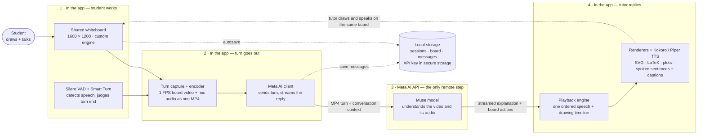
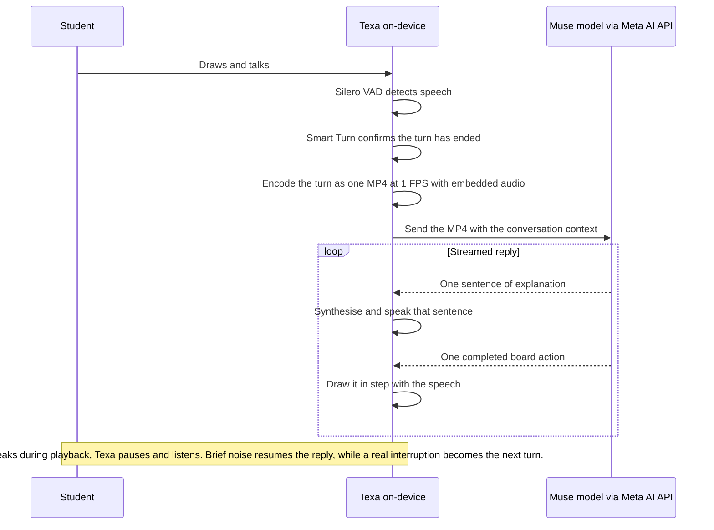

# Texa

> Your personal AI STEM tutor that can speak out loud, think, write, and draw with you on a shared whiteboard.


Texa is an AI STEM tutor (Maths, Physics, Chemistry) for middle- and high-school students. Instead of chatting in text, the student **draws and talks** on a shared board, and Texa **explains by talking and drawing back** on the same board — writing formulas, sketching diagrams, plotting functions, and pointing at the student's own work to guide them step by step.

|                  |                                                                                                     |
| ---------------- | --------------------------------------------------------------------------------------------------- |
| **Platforms**    | Android, iOS, macOS, Web (Windows planned, not yet supported)                                       |
| **Live Demo**    | https://texa.berete.dev                                                                             |
| **Full details** | [PRD (Product Requirements Document)](docs/PRD.md) · [Technical Specifications](docs/TECH_SPECS.md) |
| **License**      | [GNU AGPL v3](LICENSE)                                                                              |

## How this project was built in 10 days

The project was initialized on `Oct 26, 2026` and every single line of code was written between then and `Nov 04, 2026`, including app code, docs, branding (logos & image assets).

I came up with the idea and technical design, then validated and refined through brainstorming with Meta's muse-wonder-1.0 AI model with web search tool.
The code implementation, however, was **fully carried out by Muse Wonder 1.0 as a coding agent** — my role was to review and test its work and make minor adjustments when needed; I have probably written less than 1% of the code myself.

As a comparison, I tried building a similar project with the same features back in 2024, but it took me 2 months to build something less stable than the initial version of Texa.

---

## Contents

- [Why Texa?](#why-texa)
  - [The problem](#the-problem)
  - [The Solution](#the-solution)
- [Models](#models)
- [How it works](#how-it-works)
  - [Architecture](#architecture)
  - [One tutoring turn](#one-tutoring-turn)
  - [Key design decisions](#key-design-decisions)
- [Build & run](#build--run)
  - [1. Prerequisites](#1-prerequisites)
  - [2. Clone and fetch the submodules](#2-clone-and-fetch-the-submodules--required)
  - [3a. Native: build sherpa-onnx first](#3a-native-android--ios--macos-build-sherpa-onnx-first--required)
  - [3b. Web: build texa-webspeech first](#3b-web-build-texa-webspeech-first--required)
  - [4. Run the app](#4-run-the-app)
  - [Checks](#checks)
- [License](#license)

---

## Why Texa?

### The problem

Learning STEM is learning to _do_ — sketch the diagram, write the step, see where it goes wrong. Yet the help available to most students does not work that way:

- **Chatbots lose the actual question.** Text chat forces students to translate drawings, geometry, graphs and _"this part here"_ into typed words. Most STEM confusion is spatial, and it happens _while_ working — a photo of finished work loses the sequence of steps where the misconception occurred.
- **At home, many students have no one to ask.** This is true everywhere, but it is sharpest in developing countries like mine, where many parents never attended school or left too early to help their children with homework — however much they want to. The student gets stuck in the evening, alone, and the gap quietly compounds.
- **Human tutoring works, but does not scale to that moment.** A good tutor sits beside the student, watches the work unfold, and explains. But tutors are expensive, scheduled in advance, and scarce exactly where they are needed most — so for most students that help simply never arrives.

The result is predictable: students copy answers, memorise without understanding, and fall further behind in subjects where each topic builds on the last.

### The solution

Texa puts a patient, personal tutor **on the devices students already have** — phone, tablet and computer — available instantly, at the moment they get stuck, regardless of their parents' education, income, or where they live:

1. The student draws on a fixed **1600 × 1200 landscape whiteboard** and thinks aloud. There is no need to type out or photograph a problem, and no need to already know the right vocabulary to ask about it — they can point, draw and say _"this part here."_
2. Texa captures the board at **1 FPS** together with the microphone audio and sends that single MP4 to the tutor model — so the model sees the work _unfold_, in order, and hears the student's thinking in context.
3. The model replies with streaming spoken explanation **and** board actions. Texa speaks sentence-by-sentence while drawing each element in sync — formulas, diagrams and plots appear progressively, like a human tutor working across a desk.
4. The student can interrupt at any moment simply by speaking (voice barge-in); Texa pauses, listens, and either resumes or answers the interruption.

**Texa is not an answer machine.** The student does not simply submit a problem and receive a finished solution. Texa first makes the student try and think for themselves, then assists only as needed — with a hint, a leading question, or one step at a time — escalating only when they are genuinely stuck or have made a real attempt. The goal is not to complete the student's homework for them, but to build the understanding and confidence that let them solve the next problem on their own.

If it works, the impact is simple to state: **every student gets one-to-one help that watches them work and talks with them — not just the students whose families can provide or pay for it.** Deliberate choices keep that within reach: speech runs on-device, there is no Texa backend to run or pay for, and each turn is a small 1 FPS video payload rather than a large upload.

---

## Models

**Only Meta models are called through an API. Every other model runs locally** — natively via our sherpa-onnx fork, or in Web Workers in the browser. Speech models are downloaded on first launch (they are not bundled as app assets) and verified before first use.

| Model                                                                                                                                            | Where it runs                                                              | What it is used for                                                                                                                                                                                                                                                                                                                                                                                                                   |
| ------------------------------------------------------------------------------------------------------------------------------------------------ | -------------------------------------------------------------------------- | ------------------------------------------------------------------------------------------------------------------------------------------------------------------------------------------------------------------------------------------------------------------------------------------------------------------------------------------------------------------------------------------------------------------------------------- |
| **Muse Wonder 1.0** (`muse-wonder-1.0`, default), **Muse Spark 1.3** (`muse-spark-1.3`, `muse-spark-1.3-contributor`), or a custom Meta model ID | ☁️ **Meta AI API** (`https://api.meta.ai/v1`) — the only API-called models | The tutor itself: understands each turn's board video + embedded audio, reasons (optional per-session reasoning effort), streams the spoken explanation and emits the board tool calls. Also transcribes older turn videos in the background (see _Long sessions_ below) and maintains the per-session observation / cross-session student memory via tools. Chosen once when a session is created and fixed for that session's life. |
| **Silero VAD v6.2** (Voice Activity Detection)                                                                                                   | 🖥️ Local                                                                   | 🎙️ Detects speech vs. silence in the 16 kHz microphone stream; starts and segments student turns on every platform.                                                                                                                                                                                                                                                                                                                   |
| **Smart Turn v3.2** (int8)                                                                                                                       | 🖥️ Local                                                                   | 🎙️ End-of-turn judgement: after ~1 s of silence, decides from the last seconds of audio whether the student has actually finished speaking or is just pausing, so turns are not cut off mid-thought. Merged into our sherpa-onnx fork on native; run explicitly in the Web realtime worker.                                                                                                                                           |
| **Kokoro 82M** (Kokoro multi-lang v1.0 packaging on native; `Kokoro-82M-v1.0-ONNX` on Web)                                                       | 🖥️ Local                                                                   | 🔊 Default text-to-speech (TTS) voice (speaker/`af_heart`). Synthesises the tutor's reply one sentence chunk at a time. Web: WebGPU first, threaded-WASM fallback.                                                                                                                                                                                                                                                                    |
| **Piper** (`en_US-amy-medium`, VITS)                                                                                                             | 🖥️ Local                                                                   | 🔊 Alternative, lighter TTS voice (user-selectable in Settings; recommended on mobile). Only one TTS engine is loaded at a time.                                                                                                                                                                                                                                                                                                      |

> There is deliberately **no separate OCR/handwriting, speech-to-text or image model**: the multimodal tutor model interprets the board video and its embedded audio directly. The exception is long sessions (below), where the same tutor model transcribes older turn videos.

---

## How it works

### Architecture



### One tutoring turn



### Key design decisions

- **Streaming end to end.** The reply is consumed as it streams: each sentence is spoken as soon as its terminator arrives (prefetch depth 1), and each completed tool call starts drawing immediately — nothing waits for the full reply.
- **The tutor draws through tools, never freehand coordinates.** `write_text`, `write_math` (LaTeX), `draw_svg`, `plot_function` (evaluated on-device), `mark_landmarks` (the app computes exact coordinates from landmark _names_), `point_at`, `focus_viewport`, plus `edit_element` / `remove_element` restricted to the AI's own registered elements, and `resume_explanation`. The AI can never erase or overwrite student work.
- **Natural turn judgement.** Silero VAD finds silence; Smart Turn then decides whether the student is done. Captured turns the model judges irrelevant are answered with the exact sentinel `<[IGNORE_TURN]>` — nothing is spoken or drawn, and a suspended explanation resumes.
- **Long sessions.** Only the 4 newest student turns are sent as video (API limit: 5 videos/request); older turns are transcribed in the background by the same session model, in parallel with the tutor's reply, and thereafter sent as persisted transcripts.
- **Everything else stays on the device.** There is no Texa server and no account: sessions, boards, messages, observations and student memory persist locally (`tostore`), turn MP4s are deleted after each turn, and the API key lives only in platform secure storage. The only data that leaves the device is the turn media and context sent to the Meta AI API.
- **Identical behaviour across platforms.** Native (Android/iOS/macOS) runs speech through sherpa-onnx; Web runs the same models in the first-party [`texa-webspeech`](app/web/texa-webspeech/) Workers (ONNX Runtime Web / kokoro-js) because sherpa-onnx's Web build can use neither WebGPU nor threaded WASM. One `SpeechEngine` interface hides the difference.

Full rationale, requirements and edge cases: [PRD](docs/PRD.md) and [Technical Specifications](docs/TECH_SPECS.md).

---

## Build & run

### 1. Prerequisites

- **Flutter** (Dart SDK `^3.13.5`): follow the [official Flutter installation guide](https://docs.flutter.dev/get-started/install) for your OS, then verify with `flutter doctor`.
- Platform toolchains as required by Flutter depending on the target platform (Android Studio / Xcode command line tools, etc.).
- **Node.js + npm** — Web builds only.
- A **Meta AI API key** — you paste it into the app on first launch (stored on-device in secure storage - e.g. keychain on macos).

### 2. Clone and fetch the submodules ⚠️ required

```bash
git clone --recurse-submodules https://github.com/sitatec/texa.git
cd texa
# Already cloned without submodules? Fetch them now:
git submodule update --init --recursive
```

The `app/sherpa-onnx` submodule points to [our sherpa-onnx fork](https://github.com/sitatec/sherpa-onnx) (branch `smart-turn`), which merges Smart Turn detection into sherpa-onnx. The native build will not work without it.

### 3a. Native (Android / iOS / macOS): build sherpa-onnx first ⚠️ required

The sherpa-onnx native libraries (with ONNX Runtime statically linked) are not checked in — build them once, and again whenever the submodule changes:

```bash
cd app
./build-sherpa-onnx.sh            # all targets
./build-sherpa-onnx.sh android    # …or just: android | ios | macos
./build-sherpa-onnx.sh --help     # all options
```

iOS/macOS targets require macOS with Xcode; Android requires an Android NDK (auto-detected).

### 3b. Web: build texa-webspeech first ⚠️ required

```bash
cd app/web/texa-webspeech
npm install
npm run build
cd ../../   # back to the app dir
```

This builds the Web speech Workers into `app/web/`. (The Web app must be served with `Cross-Origin-Opener-Policy: same-origin` and `Cross-Origin-Embedder-Policy: require-corp` for threaded WASM; the VS Code launch config below already does this for local runs.)

### 4. Run the app

```bash
cd app # if not already in the app dir
flutter pub get
flutter run --wasm \
--flavor dev \
-d <device> \
--web-header=Cross-Origin-Embedder-Policy=require-corp \
--web-header=Cross-Origin-Opener-Policy=same-origin

# Replace <device>: e.g. -d chrome, -d macos, -d <android emulator id or ios simulator id>
```

Alternatively, open the repository in VS Code and launch **App (dev debug)** from [`.vscode/launch.json`](.vscode/launch.json), which also points the speech-model URLs at a local model server (run `bash app/models/startserver.sh` first; without those dart-defines, builds simply download the production models on first launch).

**First launch:** paste your Meta AI API key → **Test connection** → allow (or skip) the microphone → wait for the speech models to download and verify. Then create a session (pick its model — it is fixed for that session), draw your problem, and talk while you draw.

### Checks

```bash
cd app
flutter analyze
flutter test
dart run slang   # regenerate strings after editing lib/i18n/en.i18n.json
```

---

## License

[GNU Affero General Public License v3](LICENSE).
