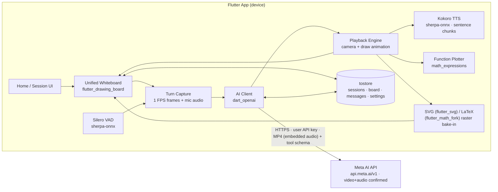
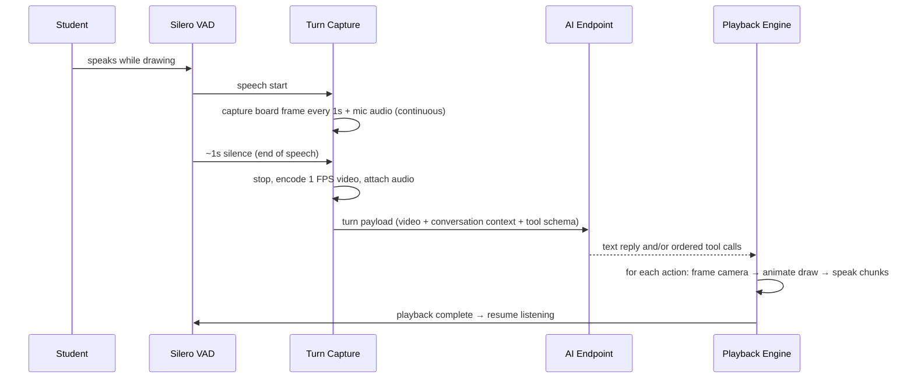

# Texa — Technical Specifications

| Field | Detail |
|---|---|
| Product | Texa — AI STEM Tutor |
| Document version | 1.6 |
| Status | Draft for prototype (MVP) |
| Version history | v1.1 (27 Oct 2026): fixed Meta AI base URL, per-session immutable model, confirmed encoder/endpoint media path, message-save ordering replacing mid-turn recovery |
| Companion document | [Product Requirements Document](PRD.md) |
| Codebase | Flutter app in `app/` (`texa`, Dart SDK ^3.13.5) |

> Conventions: **MUST/SHOULD/MAY** follow RFC 2119. Requirement IDs (FR-*) refer to PRD §9. Anything marked **Deferred** is intentionally out of the MVP and recorded here so it is designed-for, not forgotten.

---

## 1. Architecture Overview

**Supported platforms (this version): Android, iOS, macOS, and Web.** Windows is planned and is explicitly not a supported or verified platform in this version — it is excluded from the §14 verification checks and §17 platform setup until its support milestone. Mobile (Android/iOS) remains the primary target; macOS and Web must build and run, with the session experience optimised for mobile first.

No custom backend. The Flutter app is the whole system: UI, board engine, on-device speech (VAD + TTS via `sherpa-onnx`), turn media encoding, and a direct client to the Meta AI API (`dart_openai`, fixed base URL `https://api.meta.ai/v1`) using a user-supplied API key. The endpoint accepts video with embedded audio — this is a confirmed fact, not an assumption. Persistence is a local embedded database (`tostore`). 



### 1.1 Design invariants
1. **One coordinate system.** Student ink, AI actions, captured frames, pointers, and camera targets all use fixed board logical coordinates (§5). No component invents its own space.
2. **One ordered playback timeline.** AI output is executed as a strict sequence (§8.3); speech, drawing, and camera never run uncoordinated.
3. **Speech is chunked at sentence boundaries everywhere** — plain replies and `accompanying_speech` alike (§9). Captions display the chunk currently playing, exactly.
4. **The board is the source of truth** and is autosaved continuously; turn media is transient (§10.3).

## 2. Technology Stack

| Concern | Choice (in `app/pubspec.yaml`) | Notes |
|---|---|---|
| UI framework | Flutter (Material 3), Google Sans Flex, existing `lib/core/theme.dart` | Light/dark themes already defined (blue `#3B82F6` primary; red/green/yellow accents) |
| AI API client | `dart_openai` ^8.0.0 | Fixed base URL `https://api.meta.ai/v1` (compile-time constant, never user-entered); API key from Settings; model stored per session (§4.2) |
| Whiteboard | `flutter_drawing_board` ^1.0.1+2 | Single canvas: ink, zoom/pan, undo/redo, eraser, frame capture |
| SVG rendering | `flutter_svg` ^2.3.0 | AI SVG → rasterised → baked onto canvas (§6.2) |
| Maths rendering | `flutter_math_fork` ^0.7.4 | LaTeX → high-res raster → baked onto canvas (§6.3) |
| Function plotting | `math_expressions` ^3.2.0 | Analytic evaluation on-device (§6.4) |
| On-device speech | `sherpa_onnx` ^2.0.1 | Silero VAD + Kokoro TTS. **Smart Turn is Deferred** (needs custom sherpa-onnx build) |
| Mic capture | `record` ^7.1.2 (+ `audio_session` ^0.2.4) | PCM/WAV capture; audio-session config for playback/recording coexistence |
| TTS playback | `just_audio` ^0.10.6 | Sequential chunk playback with completion callbacks |
| Turn video encoding | `flutter_quick_video_encoder` ^1.7.2 | 1 FPS board frames → lightweight video (§7) |
| Local database | `tostore` ^3.6.0 | Sessions, board snapshots, messages, settings (§10) |

State management, DI, and navigation are deliberately not prescribed beyond this rule: keep them minimal (Flutter built-ins / a single lightweight approach chosen at M1) and do not introduce a framework that fights the canvas/playback controllers.

## 3. Proposed Module Layout

```
app/lib/
  main.dart                 # bootstrap: DB, settings, model assets, runApp
  app.dart                  # MaterialApp, theme, orientation policy hooks
  core/
    theme.dart              # (existing)
    constants.dart          # board size, FPS, VAD silence, timeouts — single source
    errors.dart             # typed app errors -> user messages
  features/
    setup/                  # first-launch API config + permission flow (F-01)
    home/                   # dashboard, session cards, rename/delete (F-02)
    session/                # session screen, overlays, More sheet (F-07)
    board/                  # board controller, tools, bake-in renderers, plotter
    turn/                   # VAD, capture, encoder, turn state machine
    ai/                     # API client, tool definitions, response -> action list
    playback/               # playback timeline, camera director, TTS chunk player, captions
    settings/               # API config, captions default, data wipe
  data/
    db.dart                 # tostore collections & migrations
    models.dart             # Session, BoardSnapshot, Turn, Settings
    repositories.dart
```

Controllers that own timers/streams (VAD, capture, playback) MUST expose a single `dispose()` path; the session screen owns their lifecycle.

## 4. App Flows — Implementation Mapping

### 4.1 First launch (F-01)
`main` → load settings from `tostore`. If `apiKey` missing → Setup flow: (1) welcome, (2) API-key form with **Test connection** = minimal authenticated request via `dart_openai` against the fixed base URL `https://api.meta.ai/v1`; only a success enables Continue, (3) mic permission via `record` permission API, denial recorded as `micPermissionDenied` (app proceeds), (4) run model provisioning (§16): download the speech models from the dart-define URLs, extract Kokoro, and initialise Silero VAD + Kokoro — the flow does not continue to Home until this succeeds, with a Retry state on failure. Then Home. There is no base-URL or model field in Setup or Settings.

### 4.2 Home (F-02)
Session list query: `sessions` sorted by `updatedAt desc`. Card = title, optional subject, model, relative `updatedAt`, and thumbnail (last board raster thumbnail stored on every board save, §10). **New Session flow:** (1) show the model picker — the user selects the AI model for this session; (2) insert the session row with the selected `model`, auto-title (`Session · 27 Oct, 14:30` pattern); (3) push the Session screen. The `model` column is write-once: no repository method updates it, and no UI (session screen, session menu, Settings) exposes a model editor for an existing session. Rename = dialog updating `title` only; Delete = confirm dialog → delete session + its board/messages. Empty state when count = 0.

### 4.3 Student turn (F-04) — sequence


### 4.4 Session leave/resume (F-08)
Board controller emits debounced snapshots (≤500 ms after last change, and on `AppLifecycleState.paused/inactive` and on pop) → persisted. Resume restores elements + viewport transform exactly. No explicit save action exists anywhere.

## 5. Whiteboard Specification

### 5.1 Fixed logical size
- The board has one fixed logical size, defined once in `core/constants.dart`: **`boardWidth = 1200`, `boardHeight = 1600` logical units (3:4)**. This is a confirmed product decision. All AI coordinates, pointers, capture framing, and persisted elements use this space. `focus_viewport` targets are points/rects in this space.
- The board is rendered letterboxed/centred at any window size; the camera (pan/zoom via the drawing board's transformation controller) navigates within it. On desktop/tablet the same fixed board is used — the logical board is never resized per device.

### 5.2 Unified canvas & bake-in model
All content lives on the `flutter_drawing_board` canvas as board elements (strokes/raster elements) so zoom, pan, layering, undo/redo, and the eraser apply uniformly (FR-WB-03):
- **Student ink:** native drawing-board strokes.
- **AI SVG:** render with `flutter_svg` offscreen to a raster at ≥2× display resolution, insert as an image element at the target rect.
- **AI LaTeX:** render with `flutter_math_fork` offscreen at high resolution (transparent background), insert as an image element at the target position with the model's requested size.
- **AI text:** rendered as a rasterised text element at the target position/size/colour.
- **Plots:** evaluated and stroked by the plotter (§6.4) as native path elements where possible, raster otherwise.
- Consequence (accepted for MVP): baked AI elements are erasable and drawable-over, but not semantically editable (can't re-flow LaTeX). Semantic element identity is Deferred (§12).

### 5.3 Tools (student)
Pen (colour + width presets), eraser, undo, redo, clear-board (confirm). Tool state is session-screen state, never persisted as content. Stylus and finger input both supported; palm rejection left to platform/board defaults.

### 5.4 Camera / viewport
- Auto-framing: when an AI action carries a target rect, animate the transformation controller so the rect is centred with ~10% padding, 300–500 ms ease-in-out, clamped to board bounds.
- `focus_viewport(center|rect, zoom?)` performs the same animation with no drawing.
- If the student manually pans/zooms during AI playback, auto-framing MUST pause for the remainder of that AI turn (resume next turn). Drawing/speaking by the student during playback triggers interrupt (§8.3).

## 6. AI Board Actions (Rendering)

### 6.1 Action set (MVP tool schema)
The model responds with either a plain text message (spoken, FR-AI-01) or an ordered list of tool calls. One turn SHOULD mix freely (e.g. text is not a tool; accompanying speech attaches to actions).

| Tool | Key parameters | Rendering |
|---|---|---|
| `write_text` | `element_id`, `x, y, text, size?, color?`, `accompanying_speech?` | Text element at (x, y) |
| `write_math` | `element_id`, `x, y, latex, size?`, `accompanying_speech?` | LaTeX raster bake-in |
| `draw_svg` | `element_id`, `x, y, width, height, svg`, `accompanying_speech?` | SVG raster bake-in in rect |
| `plot_function` | `element_id`, `x, y, width, height, expression, x_min, x_max, y_min?, y_max?, color?`, `accompanying_speech?` | On-device plot (§6.4) |
| `edit_element` | `element_id`, `x?, y?, width?, height?` plus the replacement content parameter of the element's type (`text` / `latex` / `svg` / `expression…`), `accompanying_speech?` | Re-renders and/or moves/resizes the AI element with that ID, in place (§6.5) |
| `remove_element` | `element_id`, `accompanying_speech?` | Removes the AI element with that ID from the board (§6.5) |
| `point_at` | (`x, y` \| `element_id`), `label?`, `accompanying_speech?` | Animated pointer arrow/highlight ring at the point, or at the stored rect of the referenced element; transient (fades after the step) |
| `focus_viewport` | (`x, y, width?, height?, zoom?` \| `element_id`), `accompanying_speech?` | Camera move only; with `element_id`, frames that element's stored rect |

All coordinates are board logical units (§5.1), origin top-left. Every tool accepts optional `accompanying_speech` (string). The full JSON Schema for these tools is defined in the AI feature module and sent with every request; the system prompt (§8.4) is the model's contract for board size, ordering, and step granularity.


**Student-knowledge tools** (never rendered on the board; executed by the app, results handled per §8.7):

| Tool | Key parameters | App behaviour |
|---|---|---|
| `update_session_observation` | `edits` (list of `{old_text, new_text}`), `accompanying_speech?` | Applies the edits to this session's Session Observation with `applyEdits` (`features/ai/utils/file_edit.dart`), so repeated updates are cheap and surgical. Result is clamped to at most two paragraphs and persisted. If the observation is still blank, a single edit with empty `old_text` sets the initial content. |
| `update_memory` | `edits` (list of `{old_text, new_text}`), `accompanying_speech?` | Same edit mechanism applied to the cross-session student Memory, keeping it concise and current rather than append-only. |
| `search_session_observations` | `query?`, `from?`, `to?` (ISO dates) | Searches all past Session Observations (§8.7) and returns the matching dated excerpts to the model in a follow-up request within the same turn. |

**Internal control tool** (never rendered on the board; executed by the playback engine):

| Tool | Parameters | App behaviour |
|---|---|---|
| `resume_explanation` | — | After any preceding speech/actions in the same reply, resume the suspended playback queue (§8.6) from the interrupted step. No-op if nothing is suspended. |

**Ignoring a turn is NOT a tool.** It is a sentinel reply (saves the tokens a tool call would cost): if the model decides a captured turn must be ignored, its entire reply is exactly the text `<[IGNORE_TURN]>` — no other text, no tool calls. The response parser (§8.2) checks for this before anything is spoken or drawn. A reply that contains the sentinel together with any other content is invalid: nothing is spoken or drawn, and the raw reply is logged.

There is deliberately **no general erase/clear tool**: the AI cannot erase or overwrite student work (FR-AI-07) — `remove_element`/`edit_element` only accept IDs from the AI element registry (§6.5), which contains only AI-created elements. Corrections to student work are expressed with `point_at`, circling via `draw_svg`, and adjacent new working.

### 6.2 SVG
Render offscreen (`PictureRecorder`/`flutter_svg` drawable → image) at scale factor ≥2, then insert. Invalid SVG XML → action skipped + locally logged (FR-AI-06). **No repair/retry in MVP (Deferred, §12).**

### 6.3 LaTeX
Render with `flutter_math_fork` (`Math.tex`) offscreen with transparent background at high tex pixel density, then insert. Parse/render failure → skip action, log. Colour defaults to board ink colour unless specified.

### 6.4 Function plotter
Parse `expression` with `math_expressions` (variable `x`), sample ≥200 points across `[x_min, x_max]`, map through the action rect with `y_min/y_max` (auto-fit from samples if omitted), clip discontinuities (non-finite/large jumps break the path). Draw axes/ticks minimally (axis lines + range labels) unless the model draws its own via SVG. The model MUST NOT supply coordinates; the tool schema has no such field (FR-AI-03).

### 6.5 AI element identifiers & registry
- `element_id` is **required** on every element-creating tool (`write_text`, `write_math`, `draw_svg`, `plot_function`). The AI chooses it; the system prompt instructs short semantic snake_case IDs unique within the session (e.g. `eq_main`, `triangle_abc`, `force_arrow_weight`). IDs are namespaced per session.
- The board maintains a persisted **AI element registry**: `element_id → { type, rect (x, y, width, height), rasterAssetPath, createdInTurnId }`. It is stored inside the board snapshot (§10.1) and restored on resume, so IDs stay valid across sessions relaunches.
- Creating an element with an ID that already exists in the registry is an error: the action is skipped and logged (the model must use `edit_element` for changes; the prompt states this). Referencing an unknown ID in `edit_element`/`remove_element`/`point_at`/`focus_viewport` likewise skips and logs that action.
- `edit_element` re-renders the replacement content through the same bake-in pipeline (§6.2–§6.4), swaps the raster asset (deleting the old file), and updates the stored rect if geometry parameters were given. Layer order is preserved on edit; a removed element's asset file is deleted.
- Student strokes are never entered into this registry and have no AI-visible ID; there is therefore no way for a tool call to address them (FR-AI-11).

## 7. Student Turn Capture

### 7.1 VAD & turn finalisation (MVP: VAD only)
- Silero VAD via `sherpa_onnx` consumes the mic stream (16 kHz mono PCM from `record`, `audio_session` configured for record+playback).
- State machine: `idle → (speech start) capturing → (~1000 ms continuous silence, constant `vadSilenceMs`) finalising → sending → aiPlaying → idle`. Smart Turn is **Deferred** (custom sherpa-onnx build required) and MUST NOT be referenced in MVP code paths.
- Mic muted ⇒ VAD/capture pipeline stopped; muting mid-capture finalises the turn if any speech was captured, else discards it (FR-SE-04).
- Empty turns (no frames / no speech energy) are discarded without an API call.

### 7.2 Frame + audio capture
- While `capturing`: grab a board snapshot at **1 FPS** (`frameInterval = 1000 ms`) using the drawing board's capture API, downscaled so the short side ≤ 540 px ("540p": 540×720 for the 3:4 board). Timestamps are monotonic from turn start.
- Mic audio is recorded continuously for the whole turn (not per-frame) so speech between frames is preserved.
- Student drawing *without* speech: capture starts on speech only (per architecture). Note as known limitation — a student who only draws silently produces no turn in MVP; the status pill SHOULD hint "I'm listening — tell me what you're doing".

### 7.3 Encoding & payload (definitive — no alternatives)
`flutter_quick_video_encoder` 1.7.2 takes raw RGBA image frames and raw PCM audio frames and muxes them into a single MP4 (H.264 + AAC, native AVFoundation/MediaCodec). The encoder is used exactly as follows:

```dart
await FlutterQuickVideoEncoder.setup(
  width: 540, height: 720,          // board 1200x1600 downscaled to 540p (3:4)
  fps: 1,
  videoBitrate: 500000,
  profileLevel: ProfileLevel.highAutoLevel,
  audioChannels: 1,
  audioBitrate: 64000,
  sampleRate: 16000,                // matches VAD + mic capture (16 kHz mono)
  filepath: '<turnTempDir>/turn_<id>.mp4',
);
// once per second of turn:
await FlutterQuickVideoEncoder.appendVideoFrame(rawRgba); // exactly 540*720*4 bytes
await FlutterQuickVideoEncoder.appendAudioFrame(rawPcm);  // exactly 16000*1*2/1 = 32000 bytes
await FlutterQuickVideoEncoder.finish();
```

Rules:
- Mic capture produces a continuous 16 kHz mono 16-bit little-endian PCM stream (`record` stream mode). The turn recorder buffers this stream and, at each 1-second tick, appends the board frame (RGBA from the board capture, resized to 540×720) followed by that second's 32000-byte PCM chunk. Video and audio therefore stay in lock-step at 1 FPS.
- Final partial second: the last PCM chunk is zero-padded (silence) to exactly 32000 bytes; the last video frame is appended once. No chunk is ever truncated.
- The output is one MP4 file with embedded audio. That file is sent as the video input of the turn request to `https://api.meta.ai/v1` (endpoint confirmed to accept video with embedded audio). There is no separate audio upload and no keyframe fallback path.
- Payload also includes: system prompt (§8.4), conversation context (§8.2), tool schemas (§6.1), board size (1200×1600), and the session's model. Turn MP4 files live in a temp directory and are deleted after the turn completes (success or terminal failure), per FR-DA-03.

### 7.4 Failure handling
Encode failure → the turn is not sent; show a plain-language error and return to listening (student work stays on the board; the student simply speaks again). Send failure (offline/timeout/429/5xx) → keep board untouched, surface Retry (re-sends the same MP4 payload), never re-record the student.

## 8. AI Client, Context & Playback

### 8.1 Client
`dart_openai` configured with the compile-time base URL constant `https://api.meta.ai/v1`, the `apiKey` from Settings, and the `model` stored on the current session (immutable after creation, §4.2). Timeouts: connect 15 s, response 120 s (video turns are slow); one automatic retry on network error only (not on 4xx). Errors map to typed `AppError`s with plain-language user strings (FR flow F-09).

### 8.2 Conversation context
**Response parsing (before any playback):** (1) if the reply's entire text content, trimmed, is exactly `<[IGNORE_TURN]>` and there are no tool calls → silent-ignore path (§8.6); (2) else if the sentinel appears anywhere in a larger reply → invalid, nothing is spoken/drawn, raw reply logged; (3) else execute text + tool calls via the playback engine (§8.3). The sentinel is a plain-text protocol token, never a tool — it must cost nothing beyond those characters.

Each request carries: system prompt (§8.4), prior AI replies for this session exactly as saved in the `messages` collection (text + tool calls), the AI element registry for the session (IDs + types + rects, §6.5 — so the model knows what it can point at/edit), and the current turn's MP4 as the new user message. Prior turn videos are not resent (cost/latency); the current board state is visible in the current turn's frames. Messages are loaded from the local DB (§10), so resuming a session continues the conversation with no extra context store.

### 8.3 Playback engine (the heart of the app)
Input: ordered list of items — plain-text reply and/or tool calls (§6.1). Execution is a strictly sequential queue:

```
for item in items:
  if interrupted: stop everything, flush TTS, -> listening
  if item is text: speak(item)                      # chunked, §9
  if item is action:
     frame camera to action rect (unless student took camera, §5.4)
     start action draw-in animation
     if accompanying_speech: speak(it) concurrently with the animation
     await speech-done AND animation-done before next item
```

- Draw-in animation: raster elements fade in; plot paths animate a draw-on effect over the step duration; every draw-in lasts 300–600 ms.
- `point_at` elements are transient overlays on the canvas that fade after their step.
- Interrupt/barge-in is fully specified in §8.6. Summary: VAD stays live during playback; speech onset, student drawing, or the stop control suspends playback immediately; brief non-speech triggers resume from the interrupted chunk; real speech becomes the next student turn carrying interruption context.
- While AI is playing, student ink input remains enabled (drawing = interrupt signal, then becomes part of the next turn's frames).

### 8.4 System prompt design (v1 contract)
The system prompt lives in one versioned file (`features/ai/system_prompt.dart`, `kSystemPromptVersion`) and MUST establish all of the following:

1. **Role & pedagogy (attempt-first):** patient STEM tutor for ages 11–18. For any new problem, first ask the student to try it or to explain how they think it should be approached — never open by solving it. Then assist only as necessary: hint first, then a guided single step, escalating only when the student is stuck, has tried and missed, or asks for more help. One step at a time; short spoken turns; check understanding regularly ("Does that step make sense before I go on?"). A complete worked solution requires a genuine attempt or an explicit request after trying.
2. **Board contract:** fixed 1200×1600 board, origin top-left; tool list and when each is used (formulas → `write_math`, diagrams → `draw_svg`, curves → `plot_function` only — never hand-plotted coordinates, references → `point_at`/`focus_viewport`); every drawn element gets a unique semantic `element_id`, later steps reference those IDs to point at, edit, or remove their own elements; never erase student work (no tool can address it).
3. **Explanation etiquette on the board (FR-AI-09):**
   - Anchor first: `focus_viewport`/`point_at` the element being discussed *before* drawing anything new, so the student's eyes are in the right place.
   - One step per action; place new working in empty board space adjacent to the work it relates to — never on top of the student's writing.
   - `accompanying_speech` narrates *while* the step draws and names the element in words ("this denominator here"), never coordinates.
   - The pointer for a step stays visible for exactly that step's speech chunk, then fades.
   - End multi-step explanations with a comprehension check, not a summary dump; do not redraw a step that is already on the board.
4. **Turn judgement before answering (FR-AI-08):** the mic is always on unless muted, so every turn is first classified:
   - *Clear & addressed to the tutor* → answer normally.
   - *Unclear audio* → do not guess what was said; ask the student to repeat/rephrase ("I didn't quite catch that — say it once more?").
   - *Ambiguous reference* → state what was understood, `point_at` the candidate element (or each candidate in sequence as separate steps), and ask one specific clarifying question. Draw no solution content.
   - *Non-speech noise or speech addressed to someone else* → reply with exactly `<[IGNORE_TURN]>` and nothing else. No speech, no drawing, no tool calls.
   - *Off-topic/irrelevant to the session* → one brief kind spoken redirect; no board action.
   - *Incomplete thought / thinking aloud* → brief encouragement to continue, optionally `point_at` where the student left off. Do not complete the student's sentence with a full solution.
   - *What was heard contradicts what is on the board* → `point_at` the discrepancy and ask the student to confirm which is intended.
5. **Interruption behaviour (FR-AI-10):** when the request carries interruption context (§8.6), first handle the student's interrupting turn. Then: if they asked a side question, answer it and call `resume_explanation` (or ask "Shall I carry on from there?" when the side question was long); if they said stop/wait, acknowledge briefly and do not resume; if they changed topic, abandon the suspended explanation without comment or cleanup drawing. Never restart an explanation from the beginning and never redraw completed steps.
6. **Plain speech** for pure talk (answers, clarifying questions, encouragement); speech text is sentence-chunked for TTS (§9), so write in complete, speakable sentences — no markdown, no LaTeX syntax read aloud.
7. **Safety/on-topic** rules per PRD §12.

### 8.5 Deliberately absent in MVP
No JSON-schema validation/repair loop, no re-asking the model to fix bad output: malformed items are skipped/logged (FR-AI-06). Validation, constrained decoding, and repair retries are **Deferred** (§12) — hooks: keep raw model responses in local logs (session-scoped, wipeable) to build the future validation test corpus.

### 8.6 Speech interruption (barge-in), suspend & resume

Playback MUST be interruptible by voice at all times it is active. The mic/VAD pipeline (§7.1) stays live during playback. Echo control is a three-layer chain, all three layers mandatory (see also §17):
1. `audio_session` configures the OS session for voice communication — iOS: category `playAndRecord` + mode `voiceChat` (enables the system voice-processing unit, incl. AEC); Android: `AndroidAudioAttributes(usage: voiceCommunication, contentType: speech)`. `audio_session` itself does not process audio — it puts the platform into the mode where its AEC exists, and the configuration is (re)applied after all audio plugins have loaded, because the session is shared and plugins can overwrite it.
2. `record` is started with `RecordConfig(echoCancel: true, noiseSuppress: true, autoGain: true, encoder: pcm16bits, sampleRate: 16000, numChannels: 1)`, which engages the platform echo canceller on the capture path (Android `AcousticEchoCanceler`, iOS voice processing).
3. The §8.6 sustained-speech threshold (≥300 ms) absorbs any residual echo that survives layers 1–2.

**Suspend (on interruption trigger):**
- Triggers: (a) VAD speech-start during playback, (b) student pen/finger draws on the board, (c) stop control.
- Within 200 ms: stop `just_audio` (the current chunk is abandoned mid-chunk; chunks are the atomic unit, there is no mid-chunk resume), freeze the current draw-in animation and camera at their current state, remove transient pointers. Completed actions stay on the board exactly as drawn.
- The engine snapshots a `SuspendedPlayback` record: remaining queue, index of the interrupted action, text of the interrupted speech chunk, IDs/rects of already-completed actions in this reply. Only one suspended record exists; a new AI reply replaces it.

**False-trigger resume:**
- If the trigger was voice and the resulting captured segment contains no sustained speech (VAD segment < 300 ms — cough, bump, background blip) and no board drawing occurred, playback resumes automatically from the **start of the interrupted speech chunk** (re-synthesising that chunk), continuing the queue. Nothing is sent to the API.

**Real interruption → next turn:**
- If sustained speech (≥ 300 ms) or drawing occurred, the suspended queue does **not** auto-resume. The captured audio/video is finalised as a normal student turn (§7), and its request additionally carries `interruptionContext`: `{ interruptedActionIndex, interruptedSpeechChunk, completedActions: [{tool, rect}], suspendedStepsRemaining: n }` so the model can follow §8.4 rule 5.
- AI outcomes: speech/actions in the reply discard the suspended queue (unless the reply calls `resume_explanation`, which re-enters it after the reply's own items); a `<[IGNORE_TURN]>` reply (noise/side conversation) **resumes** the suspended queue from the interrupted chunk; no suspended record ⇒ `<[IGNORE_TURN]>` simply returns to listening.
- Stop control with no following speech: discard the suspended queue entirely, clear captions, state → listening. The student can ask the tutor to continue in their next turn; the model then re-plans from the board state (completed steps are visible in the turn frames).

**Drawing-only interruption:** pen input suspends playback as above; no API turn is created until the student speaks (the drawings are simply present in the frames of that next turn) or taps stop (queue discarded).


### 8.7 Session Observation, Memory & observation search
- **Session Observation (per session):** a single short text, stored per session (`observations` collection: `sessionId`, `date`, `content`), starting blank. The tutor updates it progressively during a session with `update_session_observation`, whose `edits` are applied by `applyEdits` from `features/ai/utils/file_edit.dart` (exact-first/fuzzy matching, uniqueness and overlap validation) instead of rewriting the whole note each time. Content is limited to important observations about the student and is clamped to **at most two paragraphs**; an empty observation is valid and common early in a session.
- **Student Memory (cross-session):** one concise text (`memory` key) covering level, goals, preferences, learning patterns, what helps and what confuses. Updated with `update_memory` through the same `applyEdits` mechanism and revised in place as things change — it is a living summary, not a log.
- **Prompt injection:** every request's system context includes (a) the current Memory and (b) the observations of the **last 3 sessions** (by date, newest first, labelled with their dates). The current session's own observation is included as it develops.
- **Search:** `search_session_observations` supports content (case-insensitive full-text contains — the MVP substitute for embeddings), a `from`/`to` date range, or both combined. Observations are held in tostore; if/when a store without full-text support is used, the same tool degrades to date/date-range filtering only. The tool is executed by the app as soon as its call completes; its results are then sent to the model in **one follow-up streaming request within the same turn** (text context only, no resent video), and the reply to that follow-up is what gets played. At most one such follow-up per turn.

## 8.8 File uploads
- The session composer uses `TexaInputFileWidget` (`features/session/input_file_widget/`). Its state is its own (`StatefulWidget` + `setState`/`ValueNotifier`, Flutter built-ins only — **no `flutter_form_builder`**). Tapping it opens a modal (`showModalBottomSheet`) whose upload options depend on the platform (gallery/camera/file picker on mobile, file picker on desktop/web, plus in-app audio recording when audio uploads are enabled), followed by a vertically scrollable responsive grid (`GridView` with a max-cross-axis-extent delegate) of selected files: preview (image bytes, audio playback control, or a type icon) plus file name, each removable. Selected files attach to the next student turn: images/documents are included with that turn so the tutor can see the student's own material; the 45 MB per-file limit and max-count are enforced before sending.

## 9. TTS — Sentence Chunking, Playback, Captions

### 9.1 Chunking rule (FR-SP-01)
All speech text is split at **full-stop sentence punctuation** before synthesis:

```
splitSpeech(text):
  chunks = []
  split on sentence terminators '.', '!', '?' that are followed by whitespace or end-of-text
  (keeping the terminator attached to its chunk)
  trim each chunk; drop empties
  if no terminator found: the whole text is one chunk
```

- MVP implementation is intentionally naive (single regex pass, e.g. `(?<=[.!?])\s+`). Known imperfections — decimals ("3.14"), abbreviations ("e.g.") may split oddly; accepted for prototype, listed in §12 for hardening (protect decimals/abbreviations before splitting). Chunks MUST NOT be split further by length in MVP.
- Each chunk is synthesised independently by Kokoro (`sherpa_onnx` offline TTS, §16.3) into float samples in memory, converted in memory to a complete 16-bit PCM WAV byte array (header + samples — no temp files), and played in order via `just_audio` (§16.4); synthesis of chunk *n+1* starts while chunk *n* plays (prefetch pipeline of depth exactly 1) to hide latency.
- Playback of a multi-item AI turn (§8.3) awaits the final chunk of the current item before the next item.

### 9.2 Captions (FR-SP-03)
A caption controller exposes `currentChunk: String?` (set on chunk playback start, cleared on completion/interrupt). The caption overlay renders it iff captions are enabled (per-session toggle, default from Settings). It shows **exactly the text sent to TTS for the chunk now playing** — including for plain-text replies.

### 9.3 Audio plumbing
`audio_session`: playback category during TTS, record+playback during capture; duck/pause any app audio on interrupt. Kokoro voice/speed are constants in `constants.dart` (voice selectable later).

## 10. Data Model & Persistence (`tostore`)

### 10.1 Collections
| Collection | Fields (key ones) |
|---|---|
| `settings` (single row) | `apiKey`, `captionsDefault`, `micPermissionDenied` — no base URL (fixed constant) and no model (per-session) |
| `sessions` | `id`, `title`, `subject?`, `model` (required, write-once — set at creation, never updated), `createdAt`, `updatedAt`, `thumbnailPath?` |
| `board_snapshots` | `sessionId` (key), `elementsJson` (serialised board elements incl. image-element asset refs), `aiElementRegistryJson` (§6.5: element_id → type/rect/asset), `viewportJson` (transform), `updatedAt` |
| `observations` | `sessionId`, `date`, `content` (Session Observation, ≤2 paragraphs; blank at session start) |
| `memory` (single value) | concise cross-session student Memory text |
| `messages` | `id`, `sessionId`, `role` (student/ai), `kind` (video-turn/text/actions), `payloadJson` (for AI: text + tool calls exactly as received; for student: local MP4 path until the turn completes, then null), `createdAt`. A student message row is inserted when the turn is sent; an AI message row is inserted when the response is received, before playback starts (§10.5) |

Raster assets created by bake-in (SVG/LaTeX renders, thumbnails) are files under app documents dir, referenced by path from `elementsJson`; deleting a session deletes its files.

### 10.2 Autosave
Debounced snapshot writes (≤500 ms after change + lifecycle flush, §4.4). Writes are whole-snapshot for MVP simplicity (boards are small); incremental element journaling is Deferred.

### 10.3 Retention
Turn MP4 files: deleted after successful turn completion (or after retry is abandoned); the `messages.payloadJson` reference is nulled at deletion. Board and saved messages persist for the session's life. Settings → "Delete all data" wipes collections + files + key.

### 10.5 Message saving & app termination (this version's rule)
There is **no app-killed-mid-turn recovery flow** in this version, by product decision. The rule that makes that acceptable is strict save ordering:
1. When a student turn is finalised, its `messages` row is inserted **as it is sent**.
2. When the AI response arrives, its `messages` row is inserted **as it is received, before playback begins**.
3. Board snapshots autosave per §10.2.

Because persistence is a local DB, killing/restarting the app at any point loses nothing already sent or received; on relaunch the session simply shows the saved board and message history. An AI reply that was received but not yet played is not replayed automatically — it exists in history and its board actions, if playback had already drawn any, are in the board snapshot. No in-flight-turn reconstruction is implemented.

### 10.6 API key storage (prototype)
Stored in `tostore` settings as plain text — acceptable ONLY for this prototype (user's own key, own device, no backend). Labelled as-is in code comments; migration to platform secure storage is Deferred (§12) and required before any distribution.

## 11. Session Screen UI Implementation

- **Orientation:** on entering Session (mobile form factor), lock to portrait (`SystemChrome.setPreferredOrientations([portraitUp])`); restore on exit. Desktop/wide windows unaffected.
- **Layout:** `Stack` — board (centred, letterboxed) → top status pill (Listening/Capturing/Thinking/Speaking) → board toolbar (pen/eraser/undo/redo/clear) → bottom caption area → overlay control cluster.
- **Overlays (FR-SE-01/02):** mic (mute/unmute, destructive-tinted when muted), captions (CC toggle), fullscreen. Breakpoint: width < 600 dp (or mobile platform) ⇒ collapse into a single **More** (⋯) button that expands the cluster vertically on tap and auto-collapses on selection/outside tap. Fullscreen toggles `SystemChrome` immersive modes and restores on exit.
- **Visuals:** follow PRD §10 and `core/theme.dart` — floating translucent pills/cards, 14 dp radii, blue primary, minimal chrome; the board is the hero. All overlay buttons ≥44 pt targets with tooltips/semantics.

## 12. Deferred Items & Hardening Backlog (Explicit)

| # | Item | Trigger to build |
|---|---|---|
| D1 | AI output schema validation + auto-repair/retry loop (validate SVG/LaTeX/tool args, re-prompt on failure) | After MVP works end-to-end (per product decision); use logged raw responses as test corpus |
| D2 | Smart Turn detection | Requires custom `sherpa-onnx` build; after VAD-only loop is validated |
| D3 | Semantic registry for *student* elements ("the term you circled") — AI-created elements already have IDs in the MVP (§6.5) | When AI-element IDs + coordinates prove insufficient in tests |
| D4 | Full-duplex echo handling beyond platform echo cancellation + §8.6 thresholds (e.g. learned AEC) | If speakerphone echo causes false barge-ins in testing |
| D5 | Secure API-key storage (Keychain/Keystore) | Before any external distribution |
| D6 | TTS chunking hardening (decimals, abbreviations, very long sentences → secondary split) | When chunking glitches observed in testing |
| D7 | Incremental board persistence, board-history scrubbing | If whole-snapshot saves ever profile hot |
| D8 | Accounts/backend/key proxy, cost dashboard, curriculum, analytics | Post-prototype |

## 13. Performance, Reliability & Testing

- **Budgets:** turn payload target < 2 MB (1 FPS × 540p × typical ≤60 s turn); speech-start→capture < 300 ms; chunk synthesis hidden by prefetch; board pan/zoom 60 fps (raster bake-in keeps element count low).
- **Timeouts/retries:** §8.1. All AI/TTS/VAD failures degrade per PRD F-09; the board NEVER blocks on network.
- **Testing:** unit — speech chunker (terminators, decimals edge documented), plotter sampling/clipping, payload builder, autosave debounce; widget — Home empty/list states, overlay More expand/collapse, caption shows current chunk; golden/integration — bake-in renderers produce non-blank rasters, full turn pipeline with a fake AI endpoint (recorded response) on device; manual moderated tests per PRD §13.
- **Observability (local only):** structured local logs per turn (timings, payload size, skipped actions, raw responses) viewable/exportable from Settings for prototype debugging; no telemetry leaves the device.

## 14. Implementation Verification

Every design question in this spec is already decided; this section does not reopen any of them. These are pass/fail checks that the *finished implementation* matches the spec on real devices (e.g. "the MP4 from §7.3 really has synchronised audio"). If a check fails, the implementation is wrong and gets fixed — the specified design (formats, packages, flows) stays as written:

1. **Encoder round-trip:** encode a 10-second turn per §7.3 on Android and iOS; verify the MP4 plays with audible, in-sync audio and `finish()` produces a valid file at 1 FPS / 540×720.
2. **Canvas bake-in:** SVG + LaTeX rasterised into `flutter_drawing_board`; verify erase/zoom/pan behaviour and crispness at maximum zoom at the specified ≥2× raster scale.
3. **Speech on device:** Silero VAD streaming + Kokoro chunk synthesis measured on a mid-range Android phone and an iPhone; verify chunk n+1 prefetch keeps playback gapless.
4. **Save ordering:** kill the app (a) immediately after sending a turn, (b) immediately after receiving a reply; verify §10.5 — saved board + messages are intact on relaunch.
5. **Barge-in (§8.6):** during playback, (a) a cough does not cancel the explanation and playback resumes from the interrupted chunk, (b) sustained speech stops TTS within 200 ms and is captured as the next turn, (c) side conversation answered with `<[IGNORE_TURN]>` resumes the suspended explanation.

## 15. Resolved Decisions (for the record)

| Question | Decision |
|---|---|
| Endpoint | Meta AI API; base URL fixed at `https://api.meta.ai/v1`, never user-entered |
| Turn media format | Single MP4, 1 FPS video + embedded audio, via `flutter_quick_video_encoder` raw RGBA + raw PCM input (§7.3). Endpoint acceptance of video with embedded audio is confirmed |
| Model selection | Chosen once per session at creation; immutable for the life of the session |
| Board size | Fixed 1200×1600 logical units |
| App-killed mid-turn | No recovery flow; messages saved to the local DB as sent/received (§10.5) |
| Turn detection | Silero VAD only; Smart Turn deferred (custom sherpa-onnx build) |
| AI speech interruption | Voice barge-in is in the MVP: suspend within 200 ms, false-trigger (<300 ms) resume from chunk start, real interruption becomes the next turn with interruption context; a `<[IGNORE_TURN]>` reply resumes a suspended explanation (§8.6) |
| Unclear / irrelevant captured turns | Model judges every turn (§8.4 rule 4): clarify with pointing, brief redirect, prompt to continue, or the exact sentinel reply `<[IGNORE_TURN]>` — never guess an answer, and ignoring is never a tool call |

## 16. On-Device Speech Models — Provisioning & sherpa-onnx Usage

### 16.1 Sources (exact)
The model files are **never bundled as Flutter assets** (the Kokoro archive alone is ~140 MB). They live in the repo at `app/models/` (with its `.gitignore`) and are downloaded by the app on first launch. Each URL is a **dart-define whose default value is the production URL**, so a plain build always talks to production:

| Model | Dart-define | Production URL (the define's default) |
|---|---|---|
| Kokoro TTS (int8, multi-lang) | `KOKORO_MODEL_URL` | `https://github.com/k2-fsa/sherpa-onnx/releases/download/tts-models/kokoro-int8-multi-lang-v1_1.tar.bz2` |
| Silero VAD | `SILERO_VAD_MODEL_URL` | `https://github.com/k2-fsa/sherpa-onnx/releases/download/asr-models/silero_vad.onnx` |
| Smart Turn v3.2 (int8) | `SMART_TURN_MODEL_URL` | `https://huggingface.co/soniqo/Smart-Turn-v3.2-ONNX/resolve/main/smart-turn-v3.2-int8.onnx` |

```dart
// core/constants.dart — the only place these are read
const kokoroModelUrl = String.fromEnvironment(
  'KOKORO_MODEL_URL',
  defaultValue: 'https://github.com/k2-fsa/sherpa-onnx/releases/download/tts-models/kokoro-int8-multi-lang-v1_1.tar.bz2',
);
const sileroVadModelUrl = String.fromEnvironment(
  'SILERO_VAD_MODEL_URL',
  defaultValue: 'https://github.com/k2-fsa/sherpa-onnx/releases/download/asr-models/silero_vad.onnx',
);
const smartTurnModelUrl = String.fromEnvironment(
  'SMART_TURN_MODEL_URL',
  defaultValue: 'https://huggingface.co/soniqo/Smart-Turn-v3.2-ONNX/resolve/main/smart-turn-v3.2-int8.onnx',
);
```

**Local development:** `app/models/` holds the three files in the repo. `app/startserver.sh` serves that folder over HTTP (`python3 -m http.server`, default port 8765, all interfaces, fails fast listing any missing file). The "App (dev debug)" configuration in `.vscode/launch.json` (repo root) passes `--dart-define=KOKORO_MODEL_URL=http://127.0.0.1:8765/kokoro-int8-multi-lang-v1_1.tar.bz2`, `--dart-define=SILERO_VAD_MODEL_URL=http://127.0.0.1:8765/silero_vad.onnx`, and `--dart-define=SMART_TURN_MODEL_URL=http://127.0.0.1:8765/smart-turn-v3.2-int8.onnx`, so development builds download from the local server. Workflow: run `./startserver.sh` from `app/`, then launch from VS Code. For a physical device, replace `127.0.0.1` in the defines with the dev machine's LAN address (the server binds all interfaces).

### 16.2 Provisioning flow (first launch)
1. A dedicated `ModelProvisioningService` owns `<appSupportDirectory>/models/` and a `models.json` manifest recording, per model: resolved source URL, installed version/directory, and a `verified` flag.
2. **All builds download** from the resolved dart-define URLs (§16.1) — production by default, the local `startserver.sh` server under the VS Code dev launch config. First launch shows one download screen with per-file and overall progress and a Retry action on failure. Models are required: the app does not enter Home until provisioning succeeds.
3. The Kokoro `.tar.bz2` is extracted with the `archive` package (bzip2 + tar decode) into `models/kokoro-int8-multi-lang-v1_1/`; the extracted tree must contain `model.int8.onnx`, `voices.bin`, `tokens.txt`, `lexicon-us-en.txt`, and `espeak-ng-data/`. `silero_vad.onnx` and `smart-turn-v3.2-int8.onnx` are stored as single files.
4. Verification before marking `verified`: Kokoro and Silero are actually initialised through sherpa-onnx (§16.3/§7.1) against the installed paths. Smart Turn is downloaded and stored but **not loaded in the MVP** (its use remains Deferred, D2 — it needs the custom sherpa-onnx build); verification for it is file-present and non-empty.
5. Later launches skip provisioning when the manifest shows all three verified. Deleting app data re-runs the flow. Downloads go to a temp file first and are moved into place only when complete, so a killed download never leaves a half-written model marked verified.

### 16.3 Kokoro TTS via sherpa-onnx (per `dart-api-examples/tts/bin/kokoro-en-lexicon.dart`)
```dart
await sherpa_onnx.initBindingsAsync(); // once at startup
final config = sherpa_onnx.OfflineTtsConfig(
  model: sherpa_onnx.OfflineTtsModelConfig(
    kokoro: sherpa_onnx.OfflineTtsKokoroModelConfig(
      model: '<models>/kokoro-int8-multi-lang-v1_1/model.int8.onnx',
      voices: '<models>/kokoro-int8-multi-lang-v1_1/voices.bin',
      tokens: '<models>/kokoro-int8-multi-lang-v1_1/tokens.txt',
      lexicon: '<models>/kokoro-int8-multi-lang-v1_1/lexicon-us-en.txt',
      dataDir: '<models>/kokoro-int8-multi-lang-v1_1/espeak-ng-data',
    ),
    numThreads: 1,
    debug: false,
  ),
  maxNumSentences: 1, // Texa chunks sentences itself (§9); the engine must never re-split
);
final tts = sherpa_onnx.OfflineTts(config);
final audio = tts.generateWithConfig(
  text: chunk,
  config: sherpa_onnx.OfflineTtsGenerationConfig(sid: kKokoroSpeakerId, speed: kKokoroSpeed, silenceScale: config.silenceScale),
);
// audio.samples (Float32) + audio.sampleRate -> in-memory WAV bytes (§16.4). tts.free() on dispose.
```
One `OfflineTts` instance is created after provisioning and kept for the app's lifetime (creation is expensive); synthesis calls are serialised through the chunk pipeline (§9).

### 16.4 WAV playback via just_audio `StreamAudioSource`
Kokoro output is played from memory — never via temp files — through a dedicated source class:
```dart
class WavStreamAudioSource extends StreamAudioSource {
  WavStreamAudioSource(this.bytes);
  final List<int> bytes; // a complete WAV file (header + 16-bit PCM)
  @override
  Future<StreamAudioResponse> request([int? start, int? end]) async {
    start ??= 0;
    end ??= bytes.length;
    return StreamAudioResponse(
      sourceLength: bytes.length,
      contentLength: end - start,
      offset: start,
      stream: Stream.value(bytes.sublist(start, end)),
      contentType: 'audio/wav', // WAV bytes — not the 'audio/mpeg' placeholder from generic examples
    );
  }
}
// per chunk: await player.setAudioSource(WavStreamAudioSource(wavBytes)); player.play();
// chunk completion is observed on player.playerStateStream (ProcessingState.completed),
// which advances the playback queue and updates captions (§9.2).
```
`StreamAudioSource` is served by just_audio through a localhost proxy, which is why the platform cleartext exceptions in §17 are scoped to localhost only.

### 16.5 Silero VAD via sherpa-onnx (per `dart-api-examples/vad/bin/vad.dart`)
```dart
final vad = sherpa_onnx.VoiceActivityDetector(
  config: sherpa_onnx.VadModelConfig(
    sileroVad: sherpa_onnx.SileroVadModelConfig(
      model: '<models>/silero_vad.onnx',
      minSilenceDuration: 1.0, // = kVadSilence (turn finalisation, §7.1)
      minSpeechDuration: 0.3,  // = barge-in sustained-speech threshold (§8.6)
    ),
    numThreads: 1,
    debug: false,
  ),
  bufferSizeInSeconds: 10,
);
// mic PCM16 (16 kHz mono) -> Float32 samples in [-1, 1] -> fed in windowSize-sample windows:
vad.acceptWaveform(Float32List.sublistView(samples, start, start + vadConfig.sileroVad.windowSize));
// vad.isDetected() marks speech activity; segments are drained with vad.front()/vad.pop(); vad.flush() at turn end; vad.free() on dispose.
```
The same mic PCM stream feeds three consumers: VAD, the turn recorder's 1-second audio chunks (§7.3), and nothing else. Sample format conversion (PCM16 LE → Float32) happens once, in the audio input layer.

## 17. Platform Setup Requirements (implementation checklist — not yet applied)

The packages are in `pubspec.yaml` but their platform configuration has **not** been done. Implementation MUST apply exactly the following (verified against each package's README for the pinned versions); nothing here is optional for our use case:

**Android (`android/app/src/main/AndroidManifest.xml`, gradle):**
- `RECORD_AUDIO` and `INTERNET` permissions (INTERNET is also required by just_audio and the §16 downloads/model API calls).
- Create `android/app/src/main/res/xml/network_security_config.xml` permitting cleartext **only for `127.0.0.1`** and reference it via `android:networkSecurityConfig` — required by just_audio's localhost proxy for `StreamAudioSource`. Do **not** set global `android:usesCleartextTraffic="true"`.
- `record` requires minSdk ≥ 23 — satisfied by the Flutter default; verify rather than change.

**iOS (`ios/Runner/Info.plist`, `ios/Podfile`):**
- `NSMicrophoneUsageDescription` with the student-facing explanation string (from slang, §18 — plist uses the literal English string).
- `NSAppTransportSecurity` → `NSAllowsLocalNetworking: true` (localhost exception for the just_audio proxy; no arbitrary loads).
- Podfile `post_install`: add `AUDIO_SESSION_MICROPHONE=1` to `GCC_PREPROCESSOR_DEFINITIONS` (required by `audio_session` 0.2.x for microphone APIs).

**Web:** no native platform files; the browser build must compile and serve for this version. Browser microphone access requires a secure context (HTTPS/localhost) and a user-granted browser mic permission in addition to the in-app flow.

**Windows:** planned, not in this version. No Windows platform setup, entitlements, or verification is specified or required until the Windows support milestone; do not treat the existing `windows/` scaffold as a support commitment.

**macOS (`macos/Runner/Info.plist`, entitlements):**
- `NSMicrophoneUsageDescription`; `com.apple.security.device.audio-input` in both Debug and Release entitlements; `NSAppTransportSecurity` → `NSAllowsLocalNetworking: true`; `com.apple.security.network.client` in both entitlements (model download + API).

**Audio session configuration (code, applied once after all audio plugins load, §8.6 layer 1):**
```dart
await AudioSession.instance.configure(const AudioSessionConfiguration(
  avAudioSessionCategory: AVAudioSessionCategory.playAndRecord,
  avAudioSessionMode: AVAudioSessionMode.voiceChat, // iOS system voice processing + AEC
  avAudioSessionCategoryOptions: AVAudioSessionCategoryOptions.defaultToSpeaker,
  androidAudioAttributes: AndroidAudioAttributes(
    contentType: AndroidAudioContentType.speech,
    usage: AndroidAudioUsage.voiceCommunication, // signals platform AEC on capture
  ),
  androidAudioFocusGainType: AndroidAudioFocusGainType.gain,
  androidWillPauseWhenDucked: true,
));
```
Combined with `RecordConfig(echoCancel: true, noiseSuppress: true, autoGain: true)` (§8.6 layer 2), this is the complete echo/AEC story: `audio_session` selects the OS voice-communication mode, `record` engages the platform echo canceller in that mode. No `just_audio_background` (no background playback in the MVP), and no other package in the stack requires platform setup: `sherpa_onnx` ships its native libraries, `flutter_quick_video_encoder` uses stock AVFoundation/MediaCodec, `flutter_drawing_board`/`tostore` are pure Flutter/Dart for our usage.

## 18. Localisation (slang, English-only MVP)

- slang 4 is configured in `app/build.yaml`: base locale `en`, input `lib/i18n/*.i18n.json`, generated output `lib/generated/i18n/translations.g.dart`, access via `tr`. This is slang's **JSON** format — not ARB.
- **Every displayable string in the app** (labels, buttons, dialogs, errors, empty states, onboarding/setup copy, caption/status text, permission explanations shown in-app) MUST be a key in `lib/i18n/en.i18n.json`. Hard-coded UI strings in Dart are a review-blocking defect.
- Every key MUST have a translator-context entry directly beneath it using slang's `@<key>` metadata convention:
```json
{
  "session": {
    "newSession": "New session",
    "@newSession": { "description": "Primary button on the Home screen. Tapping it opens the model picker and creates a tutoring session." }
  }
}
```
  Descriptions state where the string appears, what it does, and any constraints (e.g. max length, placeholders and what they mean).
- MVP ships **English only**: no other locale files are created or translated yet. Because all strings live in the slang files from day one, adding a locale later is translation-only work with zero code changes. Placeholders use slang's `{name}` interpolation; pluralisation uses slang's plural syntax where needed.
- Model/AI-facing text (system prompt, tool schemas) and the `<[IGNORE_TURN]>` sentinel are **not** localisation strings and never pass through slang. Strings shown in native permission dialogs come from the platform files in §17 (English literals for the MVP).

## 19. Engineering & Code-Quality Standards

"MVP" describes scope, never quality. The codebase is built to production standards from the first commit:

- **Architecture:** the layered layout of §3 is binding — UI widgets hold no business logic; feature controllers own state and expose immutable state + intents; `data/` is the only layer touching `tostore`, the filesystem, and the network. Features depend on core abstractions, never on each other's internals.
- **Code health gates (all must pass before any task is 'done'):** `dart format` clean, `flutter analyze` with zero warnings (existing `flutter_lints` rules, no blanket `ignore_for_file`), and the test suite green. Generated code (`lib/generated/**`) is produced by `build_runner`/slang and never hand-edited.
- **Typing & errors:** no `dynamic` in feature code except at the API/tool-call boundary, where payloads are immediately decoded into typed models. Failures are typed `AppError`s (§3); `try/catch` never swallows silently — every catch logs with context or converts to a user-facing state.
- **Single sources of truth:** all magic numbers (board size, FPS, VAD durations, timeouts, TTS voice/speed) live in `core/constants.dart`, and the model URLs are read there exactly once via the dart-defines of §16.1; all display strings in slang (§18); the API base URL and tool schemas each exist in exactly one file.
- **Lifecycle discipline:** every stream subscription, controller, sherpa-onnx object (`free()`), encoder session, and player is owned and disposed by exactly one object; the session screen's dispose path is tested.
- **Testing (proportionate, §13 extended):** unit tests for the speech chunker, WAV header builder, model-provisioning state machine, element-registry operations, sentinel parsing, and playback suspend/resume; widget tests for Home/session overlays using `tr` strings; a fake-AI integration test replaying recorded responses (including `<[IGNORE_TURN]>` and an `edit_element` sequence) through the real playback engine.
- **Reviewability:** small, focused files (a file that needs a table of contents is two files); public APIs in feature code carry one-line doc comments stating intent, not mechanics; commits are scoped and describe the user-visible change.

*End of Technical Specifications v1.5 — companion to PRD v1.5.*

