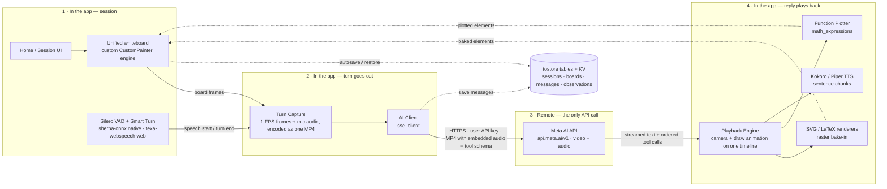
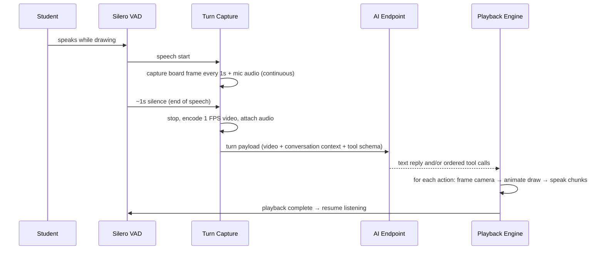

# Texa — Technical Specifications

| Field              | Detail                                                                                                                                                                                                                                                                                                                                                                                                                            |
| ------------------ | --------------------------------------------------------------------------------------------------------------------------------------------------------------------------------------------------------------------------------------------------------------------------------------------------------------------------------------------------------------------------------------------------------------------------------- |
| Product            | Texa — AI STEM Tutor                                                                                                                                                                                                                                                                                                                                                                                                              |
| Document version   | 1.7                                                                                                                                                                                                                                                                                                                                                                                                                               |
| Status             | Draft for prototype (MVP)                                                                                                                                                                                                                                                                                                                                                                                                         |
| Version history    | v1.1 (27 Oct 2026): fixed Meta AI base URL, per-session immutable model, confirmed encoder/endpoint media path, message-save ordering replacing mid-turn recovery. v1.7 (2 Nov 2026): 4-video sliding window with transcribe-ahead turn-video transcripts (older turns sent as text, chain-breaking local replay), corrected §8.1 to match the client as implemented (timeouts, no automatic retry, nested `reasoning` parameter) |
| Companion document | [Product Requirements Document](PRD.md)                                                                                                                                                                                                                                                                                                                                                                                           |
| Codebase           | Flutter app in `app/` (`texa`, Dart SDK ^3.13.5)                                                                                                                                                                                                                                                                                                                                                                                  |

> Conventions: **MUST/SHOULD/MAY** follow RFC 2119. Requirement IDs (FR-\*) refer to PRD §9. Anything marked **Deferred** is intentionally out of the MVP and recorded here so it is designed-for, not forgotten.

---

## 1. Architecture Overview

**Supported platforms (this version): Android, iOS, macOS, and Web.** Windows is planned and is explicitly not a supported or verified platform in this version — it is excluded from the §14 verification checks and §17 platform setup until its support milestone. Mobile (Android/iOS) remains the primary target; macOS and Web must build and run, with the session experience optimised for mobile first.

No custom backend. The Flutter app is the whole system: UI, board engine, on-device speech (VAD + TTS: `sherpa-onnx` on native, the first-party `texa-webspeech` workers on web — §16), turn media encoding, and a direct client to the Meta AI API (`sse_client`, fixed base URL `https://api.meta.ai/v1`) using a user-supplied API key. The endpoint accepts video with embedded audio — this is a confirmed fact, not an assumption. Persistence is a local embedded database (`tostore`).



### 1.1 Design invariants

1. **One coordinate system.** Student ink, AI actions, captured frames, pointers, and camera targets all use fixed board logical coordinates (§5). No component invents its own space.
2. **One ordered playback timeline.** AI output is executed as a strict sequence (§8.3); speech, drawing, and camera never run uncoordinated.
3. **Speech is chunked at sentence boundaries everywhere** — plain replies and `accompanying_speech` alike (§9). Captions display the chunk currently playing, exactly.
4. **The board is the source of truth** and is autosaved continuously; turn media is transient (§10.3).

## 2. Technology Stack

| Concern             | Choice (in `app/pubspec.yaml`)                                                                                    | Notes                                                                                                                                                                                                                                                                                                                                                                                                          |
| ------------------- | ----------------------------------------------------------------------------------------------------------------- | -------------------------------------------------------------------------------------------------------------------------------------------------------------------------------------------------------------------------------------------------------------------------------------------------------------------------------------------------------------------------------------------------------------- |
| UI framework        | Flutter (Material 3), Google Sans Flex, existing `lib/core/theme.dart`                                            | Light/dark themes already defined (blue `#3B82F6` primary; red/green/yellow accents)                                                                                                                                                                                                                                                                                                                           |
| AI API client       | `sse_client` ^8.0.0                                                                                               | Fixed base URL `https://api.meta.ai/v1` (compile-time constant, never user-entered); API key from Settings; model stored per session (§4.2)                                                                                                                                                                                                                                                                    |
| Whiteboard          | Custom engine (`board_widget.dart` / `board_controller.dart`)                                                     | Ink, AI elements, zoom/pan, undo/redo, eraser, frame capture. A stroke-only drawing-board package was evaluated and rejected: it cannot host heterogeneous AI elements (text/LaTeX/SVG/plot widgets), an AI element registry with edit/remove-by-id, per-element draw-on progress, or the eraser/point model Texa needs — using it would have meant wrapping/forking it around a second element system anyway. |
| SVG rendering       | `flutter_svg` ^2.3.0                                                                                              | AI SVG → rasterised → baked onto canvas (§6.2)                                                                                                                                                                                                                                                                                                                                                                 |
| Maths rendering     | `flutter_math_fork` ^0.7.4                                                                                        | LaTeX → high-res raster → baked onto canvas (§6.3)                                                                                                                                                                                                                                                                                                                                                             |
| Function plotting   | `math_expressions` ^3.2.0                                                                                         | Analytic evaluation on-device (§6.4)                                                                                                                                                                                                                                                                                                                                                                           |
| On-device speech    | Native: `sherpa_onnx` ^2.0.1. Web: `texa-webspeech` (first-party npm package in `app/web/texa-webspeech/`, §16.6) | One `SpeechEngine`/`SpeechVad` interface, two implementations. Silero VAD + Smart Turn end-of-turn detection; Kokoro or Piper TTS (user-selected, one engine at a time)                                                                                                                                                                                                                                        |
| Mic capture         | `record` ^7.1.2 (+ `audio_session` ^0.2.4)                                                                        | PCM/WAV capture; audio-session config for playback/recording coexistence                                                                                                                                                                                                                                                                                                                                       |
| TTS playback        | `just_audio` ^0.10.6                                                                                              | Sequential chunk playback with completion callbacks                                                                                                                                                                                                                                                                                                                                                            |
| Turn video encoding | `flutter_quick_video_encoder` ^1.7.2                                                                              | 1 FPS board frames → lightweight video (§7)                                                                                                                                                                                                                                                                                                                                                                    |
| Local database      | `tostore` ^3.6.0 (table engine)                                                                                   | Indexed tables for sessions/boards/messages/observations; KV only for singletons (§10)                                                                                                                                                                                                                                                                                                                         |
| Secure storage      | `flutter_secure_storage` ^10.0.0                                                                                  | The Meta AI API key, on every platform                                                                                                                                                                                                                                                                                                                                                                         |

State management, DI, and navigation are deliberately not prescribed beyond this rule: keep them minimal (Flutter built-ins / a single lightweight approach chosen at M1) and do not introduce a framework that fights the canvas/playback controllers.

## 3. Proposed Module Layout

```
app/lib/
  main.dart                 # bootstrap: DB, settings, model assets, runApp
  app.dart                  # MaterialApp, theme, orientation policy hooks
  core/
    theme.dart              # (existing)
    constants.dart          # board size, FPS, VAD silence, timeouts — single source
    errors.dart             # typed app errors -> user messages
  features/
    setup/                  # first-launch API config + permission flow (F-01)
    home/                   # dashboard, session cards, rename/delete (F-02)
    session/                # session screen, overlays, More sheet (F-07)
    board/                  # board controller, tools, bake-in renderers, plotter
    turn/                   # VAD, capture, encoder, turn state machine
    ai/                     # API client, tool definitions, response -> action list
    playback/               # playback timeline, camera director, TTS chunk player, captions
    settings/               # API config, captions default, data wipe
  data/
    db.dart                 # tostore tables/KV, secure key, migrations
    models.dart             # Session, BoardSnapshot, Turn, Settings
    repositories.dart
```

Controllers that own timers/streams (VAD, capture, playback) MUST expose a single `dispose()` path; the session screen owns their lifecycle.

## 4. App Flows — Implementation Mapping

### 4.1 First launch (F-01)

`main` → load settings from `tostore`. If `apiKey` missing → Setup flow: (1) welcome, (2) API-key form with **Test connection** = minimal authenticated request via `sse_client` against the fixed base URL `https://api.meta.ai/v1`; only a success enables Continue, (3) mic permission via `record` permission API, denial recorded as `micPermissionDenied` (app proceeds), (4) run model provisioning (§16): download the speech models from the dart-define URLs, extract Kokoro, and initialise Silero VAD + Kokoro — the flow does not continue to Home until this succeeds, with a Retry state on failure. Then Home. There is no base-URL or model field in Setup or Settings.

### 4.2 Home (F-02)

Session list query: `sessions` sorted by `updatedAt desc`. Card = title, optional subject, model, relative `updatedAt`, and thumbnail (last board raster thumbnail stored on every board save, §10). **New Session flow:** (1) show the model picker — a curated dropdown (`muse-wonder-1.0` default, `muse-spark-1.3`, `muse-spark-1.3-contributor`, or Custom revealing a free-text field; the raw `/models` list is never offered because it includes non-chat models) plus a reasoning-effort dropdown defaulting to Medium; (2) insert the session row with the selected `model`, auto-title (`Session · 27 Oct, 14:30` pattern); (3) push the Session screen. The `model` column is write-once: no repository method updates it, and no UI (session screen, session menu, Settings) exposes a model editor for an existing session. Rename = dialog updating `title` only; Delete = confirm dialog → delete session + its board/messages. Empty state when count = 0.

### 4.3 Student turn (F-04) — sequence



### 4.4 Session leave/resume (F-08)

Board controller emits debounced snapshots (≤500 ms after last change, and on `AppLifecycleState.paused/inactive` and on pop) → persisted. Resume restores elements + viewport transform exactly. No explicit save action exists anywhere.

## 5. Whiteboard Specification

### 5.1 Fixed logical size

- The board has one fixed logical size, defined once in `core/constants.dart`: **`boardWidth = 1600`, `boardHeight = 1200` logical units (4:3 landscape)**. This is a confirmed product decision. All AI coordinates, pointers, capture framing, and persisted elements use this space. `focus_viewport` targets are points/rects in this space.
- The board is rendered letterboxed/centred at any window size; the camera (pan/zoom via the drawing board's transformation controller) navigates within it. On desktop/tablet the same fixed board is used — the logical board is never resized per device.

### 5.2 Unified canvas & bake-in model

All content lives on the custom board canvas as board elements (strokes/raster elements) so zoom, pan, layering, undo/redo, and the eraser apply uniformly (FR-WB-03). **Rendering performance:** committed elements and the live stroke are separate layers — stroking only repaints the ink layer (near-duplicate points under 1.5 units are dropped); the committed layer repaints only when `BoardController.revision` changes (painter `shouldRepaint` compares revision + list identity); each rich element (text/math/SVG) is keyed and in its own `RepaintBoundary`; plot sampling is cached per element content; strokes paint as a single path (no per-segment calls, no per-element saveLayer). The session screen does not listen to the board, so drawing never rebuilds screen chrome; only the toolbar's undo/redo buttons subscribe to the board.

- **Student ink:** native drawing-board strokes.
- **AI SVG:** render with `flutter_svg` offscreen to a raster at ≥2× display resolution, insert as an image element at the target rect.
- **AI LaTeX:** render with `flutter_math_fork` offscreen at high resolution (transparent background), insert as an image element at the target position with the model's requested size.
- **AI text:** rendered as a rasterised text element at the target position/size/colour.
- **Plots:** evaluated and stroked by the plotter (§6.4) as native path elements where possible, raster otherwise.
- Consequence (accepted for MVP): baked AI elements are erasable and drawable-over, but not semantically editable (can't re-flow LaTeX). Semantic element identity is Deferred (§12).

### 5.3 Tools (student)

Pen (single colour button opening a palette overlay + width presets), **straight-line tool** (drag anchors a start point and previews a live two-point line to the current finger position, committed on lift), eraser, undo, redo, clear-board (confirm). **Eraser semantics:** rich elements (text/math/SVG/plot) touched by the eraser are removed whole; ink strokes are split — points under the eraser are cut out and the remaining runs become separate strokes, leaving a real gap (no straight bridge across the erased span, no whole-line deletion). The student may erase AI content (FR-WB-02); the AI has no tool that can erase student work. **Live ink:** the in-progress stroke/line preview paints on its own layer and must repaint on every point (the painter's `shouldRepaint` compares a monotonic tick, never the mutated stroke object). Tool state is session-screen state, never persisted as content. Stylus and finger input both supported; palm rejection left to platform/board defaults.

### 5.4 Camera / viewport

- Auto-framing: when an AI action carries a target rect, animate the transformation controller so the rect is centred with ~10% padding, 300–500 ms ease-in-out, clamped to board bounds.
- `focus_viewport(center|rect, zoom?)` performs the same animation with no drawing.
- If the student manually pans/zooms during AI playback, auto-framing MUST pause for the remainder of that AI turn (resume next turn). Drawing/speaking by the student during playback triggers interrupt (§8.3).

## 6. AI Board Actions (Rendering)

### 6.1 Action set (MVP tool schema)

The model responds with either a plain text message (spoken, FR-AI-01) or an ordered list of tool calls. One turn SHOULD mix freely (e.g. text is not a tool; accompanying speech attaches to actions).

| Tool             | Key parameters                                                                                                                                                          | Rendering                                                                                                                                                                                                                                                                                                                                                                                                                                                                                                                                                                                     |
| ---------------- | ----------------------------------------------------------------------------------------------------------------------------------------------------------------------- | --------------------------------------------------------------------------------------------------------------------------------------------------------------------------------------------------------------------------------------------------------------------------------------------------------------------------------------------------------------------------------------------------------------------------------------------------------------------------------------------------------------------------------------------------------------------------------------------- |
| `write_text`     | `element_id`, `x, y, text, size?, color?`, `accompanying_speech?`                                                                                                       | Text element at (x, y)                                                                                                                                                                                                                                                                                                                                                                                                                                                                                                                                                                        |
| `write_math`     | `element_id`, `x, y, latex, size?`, `accompanying_speech?`                                                                                                              | LaTeX raster bake-in                                                                                                                                                                                                                                                                                                                                                                                                                                                                                                                                                                          |
| `draw_svg`       | `element_id`, `x, y, width, height, svg`, `accompanying_speech?`                                                                                                        | SVG raster bake-in in rect                                                                                                                                                                                                                                                                                                                                                                                                                                                                                                                                                                    |
| `plot_function`  | `element_id`, `x, y, width, height, expression, x_min, x_max, y_min?, y_max?, color?`, `accompanying_speech?`                                                           | On-device plot (§6.4)                                                                                                                                                                                                                                                                                                                                                                                                                                                                                                                                                                         |
| `mark_landmarks` | `element_id`, `landmarks` (names only), `color?`, `accompanying_speech?`                                                                                                | App-computed labelled markers on an existing element. The model supplies only names — never coordinates. Plots: `vertex`, `roots`, `y_intercept`, `maximum`, `minimum`; SVG shapes: `vertices`, `centroid`, `circumcenter`, `incenter`, `orthocenter`, `midpoints`; any element: `center`, corners. Computed in `landmarks.dart` from the sampled curve / parsed SVG geometry (polygon, line, rect, circle; viewBox-aware) and drawn as `landmark` elements (ids `<target>_<name>`, so they can be pointed at, edited or removed like other AI elements). Names that don't apply are skipped. |
| `edit_element`   | `element_id`, `x?, y?, width?, height?` plus the replacement content parameter of the element's type (`text` / `latex` / `svg` / `expression…`), `accompanying_speech?` | Re-renders and/or moves/resizes the AI element with that ID, in place (§6.5)                                                                                                                                                                                                                                                                                                                                                                                                                                                                                                                  |
| `remove_element` | `element_id`, `accompanying_speech?`                                                                                                                                    | Removes the AI element with that ID from the board (§6.5)                                                                                                                                                                                                                                                                                                                                                                                                                                                                                                                                     |
| `point_at`       | (`x, y` \| `element_id`), `label?`, `accompanying_speech?`                                                                                                              | Animated pointer arrow/highlight ring at the point, or at the stored rect of the referenced element; transient (fades after the step)                                                                                                                                                                                                                                                                                                                                                                                                                                                         |
| `focus_viewport` | (`x, y, width?, height?, zoom?` \| `element_id`), `accompanying_speech?`                                                                                                | Camera move only; with `element_id`, frames that element's stored rect                                                                                                                                                                                                                                                                                                                                                                                                                                                                                                                        |

All coordinates are board logical units (§5.1), origin top-left. Every tool accepts optional `accompanying_speech` (string). The full JSON Schema for these tools is defined in the AI feature module and sent with every request; the system prompt (§8.4) is the model's contract for board size, ordering, and step granularity.

**Student-knowledge tools** (never rendered on the board; executed by the app, results handled per §8.7):

| Tool                          | Key parameters                                                   | App behaviour                                                                                                                                                                                                                                                                                                           |
| ----------------------------- | ---------------------------------------------------------------- | ----------------------------------------------------------------------------------------------------------------------------------------------------------------------------------------------------------------------------------------------------------------------------------------------------------------------- |
| `update_session_observation`  | `edits` (list of `{old_text, new_text}`), `accompanying_speech?` | Applies the edits to this session's Session Observation with `applyEdits` (`features/ai/utils/file_edit.dart`), so repeated updates are cheap and surgical. Result is clamped to at most two paragraphs and persisted. If the observation is still blank, a single edit with empty `old_text` sets the initial content. |
| `update_memory`               | `edits` (list of `{old_text, new_text}`), `accompanying_speech?` | Same edit mechanism applied to the cross-session student Memory, keeping it concise and current rather than append-only.                                                                                                                                                                                                |
| `search_session_observations` | `query?`, `from?`, `to?` (ISO dates)                             | Searches all past Session Observations (§8.7) and returns the matching dated excerpts to the model in a follow-up request within the same turn.                                                                                                                                                                         |

**Internal control tool** (never rendered on the board; executed by the playback engine):

| Tool                 | Parameters | App behaviour                                                                                                                                              |
| -------------------- | ---------- | ---------------------------------------------------------------------------------------------------------------------------------------------------------- |
| `resume_explanation` | —          | After any preceding speech/actions in the same reply, resume the suspended playback queue (§8.6) from the interrupted step. No-op if nothing is suspended. |

**Ignoring a turn is NOT a tool.** It is a sentinel reply (saves the tokens a tool call would cost): if the model decides a captured turn must be ignored, its entire reply is exactly the text `<[IGNORE_TURN]>` — no other text, no tool calls. The response parser (§8.2) checks for this before anything is spoken or drawn. A reply that contains the sentinel together with any other content is invalid: nothing is spoken or drawn, and the raw reply is logged.

There is deliberately **no general erase/clear tool**: the AI cannot erase or overwrite student work (FR-AI-07) — `remove_element`/`edit_element` only accept IDs from the AI element registry (§6.5), which contains only AI-created elements. Corrections to student work are expressed with `point_at`, circling via `draw_svg`, and adjacent new working.

### 6.2 SVG

Render offscreen (`PictureRecorder`/`flutter_svg` drawable → image) at scale factor ≥2, then insert. Invalid SVG XML → action skipped + locally logged (FR-AI-06). **No repair/retry in MVP (Deferred, §12).**

### 6.3 LaTeX

Render with `flutter_math_fork` (`Math.tex`) offscreen with transparent background at high tex pixel density, then insert. Parse/render failure → skip action, log. Colour defaults to board ink colour unless specified.

### 6.4 Function plotter

Parse `expression` with `math_expressions` (variable `x`), sample ≥200 points across `[x_min, x_max]`, map through the action rect with `y_min/y_max` (auto-fit from samples if omitted), clip discontinuities (non-finite/large jumps break the path). Draw axes/ticks minimally (axis lines + range labels) unless the model draws its own via SVG. The model MUST NOT supply coordinates; the tool schema has no such field (FR-AI-03).

### 6.5 AI element identifiers & registry

- `element_id` is **required** on every element-creating tool (`write_text`, `write_math`, `draw_svg`, `plot_function`). The AI chooses it; the system prompt instructs short semantic snake_case IDs unique within the session (e.g. `eq_main`, `triangle_abc`, `force_arrow_weight`). IDs are namespaced per session.
- The board maintains a persisted **AI element registry**: `element_id → { type, rect (x, y, width, height), rasterAssetPath, createdInTurnId }`. It is stored inside the board snapshot (§10.1) and restored on resume, so IDs stay valid across sessions relaunches.
- Creating an element with an ID that already exists in the registry is an error: the action is skipped and logged (the model must use `edit_element` for changes; the prompt states this). Referencing an unknown ID in `edit_element`/`remove_element`/`point_at`/`focus_viewport` likewise skips and logs that action.
- `edit_element` re-renders the replacement content through the same bake-in pipeline (§6.2–§6.4), swaps the raster asset (deleting the old file), and updates the stored rect if geometry parameters were given. Layer order is preserved on edit; a removed element's asset file is deleted.
- Student strokes are never entered into this registry and have no AI-visible ID; there is therefore no way for a tool call to address them (FR-AI-11).

## 7. Student Turn Capture

### 7.1 VAD & turn finalisation

- Silero VAD consumes the mic stream (16 kHz mono PCM from `record`, `audio_session` configured for record+playback) behind the platform `SpeechVad` interface: Sherpa's VAD on native; the official Silero v6.2 model run directly on onnxruntime-web in the web realtime worker (§16.6). The interface is asynchronous because web VAD answers cross a worker boundary; the mic pipeline serialises windows so ordering is preserved on every platform.
- State machine: `idle → (speech start) capturing → (~1000 ms continuous silence, constant `vadSilenceMs`) → Smart Turn judgement → finalising → sending → aiPlaying → idle`. When trailing silence is reached, Smart Turn judges the captured speech (up to the last 8 s): if it predicts the student has not finished, capture resumes and the judgement repeats at the next silence instead of sending a truncated turn. On native, Sherpa applies Smart Turn internally during endpointing; on web the model runs explicitly in the realtime worker.
- Mic muted ⇒ VAD/capture pipeline stopped; muting mid-capture finalises the turn if any speech was captured, else discards it (FR-SE-04).
- Empty turns (no frames / no speech energy) are discarded without an API call.

### 7.2 Frame + audio capture

- While `capturing`: grab a board snapshot at **1 FPS** (`frameInterval = 1000 ms`) using the drawing board's capture API, downscaled so the short side ≤ 540 px ("540p": 540×720 for the 3:4 board). Timestamps are monotonic from turn start.
- Mic audio is recorded continuously for the whole turn (not per-frame) so speech between frames is preserved. Both the 1 FPS frames and the audio are fed to the streaming encoder (§7.3) as they are captured.
- Student drawing _without_ speech: capture starts on speech only (per architecture). Note as known limitation — a student who only draws silently produces no turn in MVP; the status pill SHOULD hint "I'm listening — tell me what you're doing".

### 7.3 Encoding & payload (definitive — no alternatives)

Encoding is **streaming**: the encoder is set up when capture begins, every frame is encoded as soon as it exists, and ending a turn only pads the final audio second and finalizes. No raw frames or full-turn PCM are buffered for a batch encode at the end — this keeps end-of-turn latency to finalize + send.

All platforms sit behind one `TurnVideoEncoder` interface (`setup`, `appendVideoFrame`, `appendAudioFrame`, `finish` → MP4 bytes, `abort`), selected by conditional import:

- **Native** (`turn_video_encoder_io.dart`): `flutter_quick_video_encoder` 1.7.2 takes raw RGBA image frames and raw PCM audio frames and muxes them into a single MP4 (H.264 + OPUS, native AVFoundation/MediaCodec), writing to a temp file whose bytes are read back at `finish` (file then deleted):

```dart
await encoder.setup(
  width: 720, height: 540,          // board 1600x1200 downscaled to 540p (4:3)
  fps: 1, videoBitrate: 500000,
  audioChannels: 1, audioBitrate: 32000,
  sampleRate: 16000,                // matches VAD + mic capture (16 kHz mono)
);
// once per second of turn, while the student is still speaking:
await encoder.appendVideoFrame(rawRgba); // exactly 540*720*4 bytes
await encoder.appendAudioFrame(rawPcm);  // exactly 16000*1*2/1 = 32000 bytes
final mp4Bytes = await encoder.finish();
```

- **Web** (`turn_video_encoder_web.dart`): the browser's hardware-accelerated **WebCodecs** API — `VideoEncoder` (H.264; first supported of High/Main/Baseline profiles, hardware preferred) and `AudioEncoder` (`opus`) — muxed into an MP4 byte array by **mp4-muxer** (MIT, ~74 KB UMD build vendored at `app/web/vendor/mp4-muxer.js`, loaded from `web/index.html`; no FFmpeg WASM). Video ingestion first probes (once, at encoder setup, result cached for the app's lifetime) whether a `VideoFrame` can be constructed directly from a raw RGBA `Uint8Array`; if so, buffers stream straight in, otherwise frames fall back to `OffscreenCanvas` + `ImageData` → `ImageBitmap` → `VideoFrame`. Every `VideoFrame`, `ImageBitmap` and `AudioData` is closed immediately after submission to its encoder, so memory stays flat on long turns. `finish` flushes both encoders, finalizes the muxer and returns the MP4 bytes.

Rules:

- Mic capture produces a continuous 16 kHz mono 16-bit little-endian PCM stream (`record` stream mode). A `PcmSecondBuffer` accumulates it and hands out exact one-second frames; each captured board frame is appended immediately, followed by that second's PCM frame once available (appends are serialized so video/audio stay interleaved V/A/V/A at 1 FPS — the native encoder's fixed frame sizes require exactly 32000-byte audio frames).
- Final partial second: the last PCM chunk is zero-padded (silence) to exactly 32000 bytes; one final board frame is captured at turn end. No chunk is ever truncated. Discarded/false-alarm captures call `abort` instead and send nothing.
- The output is one MP4 with embedded audio. That file is sent as the video input of the turn request to `https://api.meta.ai/v1` (endpoint confirmed to accept video with embedded audio). There is no separate audio upload and no keyframe fallback path.
- Payload also includes: system prompt (§8.4), conversation context (§8.2), tool schemas (§6.1), board size (1600×1200), and the session's model. Turn MP4 files live in a temp directory and are deleted after the turn completes (success or terminal failure), per FR-DA-03.

### 7.4 Failure handling

Encode failure → the turn is not sent; show a plain-language error and return to listening (student work stays on the board; the student simply speaks again). Send failure (offline/timeout/429/5xx) → keep board untouched, surface Retry (re-sends the same MP4 payload), never re-record the student.

## 8. AI Client, Context & Playback

### 8.1 Client

`sse_client` configured with the compile-time base URL constant `https://api.meta.ai/v1`, the `apiKey` from Settings, and the `model` stored on the current session (immutable after creation, §4.2). A session may also store a **reasoning effort** chosen in the New Session dialog (None/minimal/low/medium/high/xhigh, default Medium, immutable like the model); when set it is sent as the nested `reasoning: {effort: …}` request parameter and shown as a reasoning-effort chip on Home session cards. Timeouts: connect 60 s, response 180 s (video turns are slow); there is **no automatic retry** (`OpenAIRetryPolicy.none`) - a failed turn is surfaced and the student retries it. Errors map to typed `AppError`s with plain-language user strings (FR flow F-09).

### 8.2 Conversation context

**Response parsing (before any playback):** (1) if the reply's entire text content, trimmed, is exactly `<[IGNORE_TURN]>` and there are no tool calls → silent-ignore path (§8.6); (2) else if the sentinel appears anywhere in a larger reply → invalid, nothing is spoken/drawn, raw reply logged; (3) else execute text + tool calls via the playback engine (§8.3). The sentinel is a plain-text protocol token, never a tool — it must cost nothing beyond those characters.

Each request carries the system prompt (§8.4) - which also gains the student's cross-session Memory, the last 3 sessions' Observations and this session's own Observation (§8.7) - plus this turn's uploads and the current turn's MP4 as the new user message. How the earlier conversation is supplied depends on the session's length:

- **Within the video window (≤ 4 student video turns):** requests chain with `previous_response_id` (`store: true`); only the new turn is sent and the server reconstructs the stored conversation. The stored response id lives in each saved AI message's payload (`responseId`) and is read back from there on resume (`AiClient.latestResponseId`), so chaining survives app restarts.
- **Past the video window:** Meta AI accepts at most 5 videos per request (observed error: "request contains 6 videos, exceeding the maximum of 5 allowed per request"), and a chained request keeps every video ever stored on the chain - so chaining can never drop one. Past the window, every turn therefore **breaks the chain** (`previous_response_id` omitted) and replays the local history from the `messages` collection: AI replies as saved (text + tool calls, each replayed `function_call` paired with its stored or synthesised `function_call_output`), student text turns as text, and student video turns split at the window - the **4 newest as `input_video`** (the current turn plus the three before it) and **every older one as its persisted transcript** (see below). The fresh response id is still saved with the AI message but is not chained from while the window is active. Messages are loaded from the local DB (§10), so resuming a session continues the conversation with no extra context store.

**Turn-video transcription (`features/study_session/ai/video_transcription_prompt.dart`, `AiClient.transcribeVideo`, `SessionController._prepareTranscriptions`):** a student video turn's message payload gains `transcript`, `transcriptionStatus` (`none`/`pending`/`done`/`failed`), `transcriptionError` and `transcribedAt` alongside the local-only `videoBase64` (kept forever so the history sheet can replay the video; only the wire representation changes). Transcription is **transcribe-ahead**: when a turn is sent, the oldest video that turn still sends as video is transcribed in the background - a separate `AiClient`, one tool-less, non-stored (`store: false`) request carrying exactly that one video to the **same model**, in parallel with the tutor's reply - so its transcript is persisted before the next turn pushes it out of the window. Before a turn is sent, any turn it will already send as a transcript is awaited (normally joining the finished/in-flight ahead job); on resume, missing transcripts for all but the newest 3 video turns are re-driven oldest-first, one at a time. Status is persisted _before_ the request, so an app kill mid-transcription resumes as `pending` and is retried; a failure marks the message `failed`, is logged, never fails the tutoring turn, and is retried on the next send - until then that one history item degrades to an explicit "transcript unavailable" marker rather than re-sending the video and breaking the limit. Whole-history saves are serialized (`SessionController._saveMessages`) because a background transcription and the tutor turn can persist at the same time.

The transcription prompt demands a **self-contained record, not a summary**: the student's speech verbatim (with `[unclear: …]`/`[inaudible]`/`[illegible: …]` markers instead of guesses), every deictic reference resolved to the actual board content and approximate board coordinates it referred to ("from here to here" must name both ends), a chronological account of the board (starting state, everything written/drawn/erased/pointed at, ending state quoted exactly where legible), and the student's intent. The record must be returned inside exactly one ` ```transcript ` fenced block with nothing outside it; `AiClient.extractTranscript` stores only the block's content (discarding any stray preamble/sign-off), falling back to another fenced block, an unterminated `transcript` block, and finally the whole reply when the model ignores the format. The system prompt's _HISTORY - VIDEOS AND TRANSCRIPTS_ section tells the tutor to treat transcripts as the student's own turn, to trust their resolved references, not to invent visual detail they don't state, and to treat their board state as a historical snapshot superseded by newer video.

### 8.3 Playback engine (the heart of the app)

Input: ordered list of items — plain-text reply and/or tool calls (§6.1). Execution is a strictly sequential queue:

```
for item in items:
  if interrupted: stop everything, flush TTS, -> listening
  if item is text: speak(item)                      # chunked, §9
  if item is action:
     frame camera to action rect (unless student took camera, §5.4)
     start action draw-in animation
     if accompanying_speech: speak(it) concurrently with the animation
     await speech-done AND animation-done before next item
```

- Draw-in animation: raster elements fade in; plot paths animate a draw-on effect over the step duration; every draw-in lasts 300–600 ms.
- `point_at` elements are transient overlays on the canvas that fade after their step.
- Interrupt/barge-in is fully specified in §8.6. Summary: VAD stays live during playback; speech onset, student drawing, or the stop control suspends playback immediately; brief non-speech triggers resume from the interrupted chunk; real speech becomes the next student turn carrying interruption context.
- While AI is playing, student ink input remains enabled (drawing = interrupt signal, then becomes part of the next turn's frames).

### 8.4 System prompt design (v1 contract)

The system prompt lives in one versioned file (`features/ai/system_prompt.dart`, `kSystemPromptVersion`) and MUST establish all of the following:

1. **Role & pedagogy (attempt-first):** patient STEM tutor for ages 11–18. For any new problem, first ask the student to try it or to explain how they think it should be approached — never open by solving it. Then assist only as necessary: hint first, then a guided single step, escalating only when the student is stuck, has tried and missed, or asks for more help. One step at a time; short spoken turns; check understanding regularly ("Does that step make sense before I go on?"). A complete worked solution requires a genuine attempt or an explicit request after trying.
2. **Board contract:** fixed 1600×1200 board, origin top-left; tool list and when each is used (formulas → `write_math`, diagrams → `draw_svg`, curves → `plot_function` only — never hand-plotted coordinates, references → `point_at`/`focus_viewport`); every drawn element gets a unique semantic `element_id`, later steps reference those IDs to point at, edit, or remove their own elements; never erase student work (no tool can address it).
3. **Explanation etiquette on the board (FR-AI-09):**
   - Anchor first: `focus_viewport`/`point_at` the element being discussed _before_ drawing anything new, so the student's eyes are in the right place.
   - One step per action; place new working in empty board space adjacent to the work it relates to — never on top of the student's writing.
   - `accompanying_speech` narrates _while_ the step draws and names the element in words ("this denominator here"), never coordinates.
   - The pointer for a step stays visible for exactly that step's speech chunk, then fades.
   - End multi-step explanations with a comprehension check, not a summary dump; do not redraw a step that is already on the board.
4. **Turn judgement before answering (FR-AI-08):** the mic is always on unless muted, so every turn is first classified:
   - _Clear & addressed to the tutor_ → answer normally.
   - _Unclear audio_ → do not guess what was said; ask the student to repeat/rephrase ("I didn't quite catch that — say it once more?").
   - _Ambiguous reference_ → state what was understood, `point_at` the candidate element (or each candidate in sequence as separate steps), and ask one specific clarifying question. Draw no solution content.
   - _Non-speech noise or speech addressed to someone else_ → reply with exactly `<[IGNORE_TURN]>` and nothing else. No speech, no drawing, no tool calls.
   - _Off-topic/irrelevant to the session_ → one brief kind spoken redirect; no board action.
   - _Incomplete thought / thinking aloud_ → brief encouragement to continue, optionally `point_at` where the student left off. Do not complete the student's sentence with a full solution.
   - _What was heard contradicts what is on the board_ → `point_at` the discrepancy and ask the student to confirm which is intended.
5. **Interruption behaviour (FR-AI-10):** when the request carries interruption context (§8.6), first handle the student's interrupting turn. Then: if they asked a side question, answer it and call `resume_explanation` (or ask "Shall I carry on from there?" when the side question was long); if they said stop/wait, acknowledge briefly and do not resume; if they changed topic, abandon the suspended explanation without comment or cleanup drawing. Never restart an explanation from the beginning and never redraw completed steps.
6. **Plain speech** for pure talk (answers, clarifying questions, encouragement); speech text is sentence-chunked for TTS (§9), so write in complete, speakable sentences — no markdown, no LaTeX syntax read aloud.
7. **Safety/on-topic** rules per PRD §12.

### 8.5 Deliberately absent in MVP

No JSON-schema validation/repair loop, no re-asking the model to fix bad output: malformed items are skipped/logged (FR-AI-06). Validation, constrained decoding, and repair retries are **Deferred** (§12) — hooks: keep raw model responses in local logs (session-scoped, wipeable) to build the future validation test corpus.

### 8.6 Speech interruption (barge-in), suspend & resume

Playback MUST be interruptible by voice at all times it is active. The mic/VAD pipeline (§7.1) stays live during playback. Echo control is a three-layer chain, all three layers mandatory (see also §17):

1. `audio_session` configures the OS session for voice communication — iOS: category `playAndRecord` + mode `voiceChat` (enables the system voice-processing unit, incl. AEC); Android: `AndroidAudioAttributes(usage: voiceCommunication, contentType: speech)`. `audio_session` itself does not process audio — it puts the platform into the mode where its AEC exists, and the configuration is (re)applied after all audio plugins have loaded, because the session is shared and plugins can overwrite it.
2. `record` is started with `RecordConfig(echoCancel: true, noiseSuppress: true, autoGain: true, encoder: pcm16bits, sampleRate: 16000, numChannels: 1)`, which engages the platform echo canceller on the capture path (Android `AcousticEchoCanceler`, iOS voice processing).
3. The §8.6 sustained-speech threshold (≥300 ms) absorbs any residual echo that survives layers 1–2.

**Suspend (on interruption trigger):**

- Triggers: (a) VAD speech-start during playback, (b) student pen/finger draws on the board, (c) stop control.
- Within 200 ms: stop `just_audio` (the current chunk is abandoned mid-chunk; chunks are the atomic unit, there is no mid-chunk resume), freeze the current draw-in animation and camera at their current state, remove transient pointers. Completed actions stay on the board exactly as drawn.
- The engine snapshots a `SuspendedPlayback` record: remaining queue, index of the interrupted action, text of the interrupted speech chunk, IDs/rects of already-completed actions in this reply. Only one suspended record exists; a new AI reply replaces it.

**False-trigger resume:**

- If the trigger was voice and the resulting captured segment contains no sustained speech (VAD segment < 300 ms — cough, bump, background blip) and no board drawing occurred, playback resumes automatically from the **start of the interrupted speech chunk** (re-synthesising that chunk), continuing the queue. Nothing is sent to the API.

**Real interruption → next turn:**

- If sustained speech (≥ 300 ms) or drawing occurred, the suspended queue does **not** auto-resume. The captured audio/video is finalised as a normal student turn (§7), and its request additionally carries `interruptionContext`: `{ interruptedActionIndex, interruptedSpeechChunk, completedActions: [{tool, rect}], suspendedStepsRemaining: n }` so the model can follow §8.4 rule 5.
- AI outcomes: speech/actions in the reply discard the suspended queue (unless the reply calls `resume_explanation`, which re-enters it after the reply's own items); a `<[IGNORE_TURN]>` reply (noise/side conversation) **resumes** the suspended queue from the interrupted chunk; no suspended record ⇒ `<[IGNORE_TURN]>` simply returns to listening.
- Stop control with no following speech: discard the suspended queue entirely, clear captions, state → listening. The student can ask the tutor to continue in their next turn; the model then re-plans from the board state (completed steps are visible in the turn frames).

**Drawing-only interruption:** pen input suspends playback as above; no API turn is created until the student speaks (the drawings are simply present in the frames of that next turn) or taps stop (queue discarded).

### 8.7 Session Observation, Memory & observation search

- **Session Observation (per session):** a single short text, stored per session (`observations` collection: `sessionId`, `date`, `content`), starting blank. The tutor updates it progressively during a session with `update_session_observation`, whose `edits` are applied by `applyEdits` from `features/ai/utils/file_edit.dart` (exact-first/fuzzy matching, uniqueness and overlap validation) instead of rewriting the whole note each time. Content is limited to important observations about the student and is clamped to **at most two paragraphs**; an empty observation is valid and common early in a session.
- **Student Memory (cross-session):** one concise text (`memory` key) covering level, goals, preferences, learning patterns, what helps and what confuses. Updated with `update_memory` through the same `applyEdits` mechanism and revised in place as things change — it is a living summary, not a log.
- **Prompt injection:** every request's system context includes (a) the current Memory and (b) the observations of the **last 3 sessions** (by date, newest first, labelled with their dates). The current session's own observation is included as it develops.
- **Search:** `search_session_observations` supports content (case-insensitive full-text contains — the MVP substitute for embeddings), a `from`/`to` date range, or both combined. Observations are held in tostore; if/when a store without full-text support is used, the same tool degrades to date/date-range filtering only. The tool is executed by the app as soon as its call completes; its results are then sent to the model in **one follow-up streaming request within the same turn** (text context only, no resent video), and the reply to that follow-up is what gets played. At most one such follow-up per turn.

## 8.8 File uploads

- The session composer uses `TexaInputFileWidget` (`features/session/input_file_widget/`). Its state is its own (`StatefulWidget` + `setState`/`ValueNotifier`, Flutter built-ins only — **no `flutter_form_builder`**). Tapping it opens a modal (`showModalBottomSheet`) whose upload options depend on the platform (gallery/camera/file picker on mobile, file picker on desktop/web, plus in-app audio recording when audio uploads are enabled), followed by a vertically scrollable responsive grid (`GridView` with a max-cross-axis-extent delegate) of selected files: preview (image bytes, audio playback control, or a type icon) plus file name, each removable. Selected files attach to the next student turn: images/documents are included with that turn so the tutor can see the student's own material; the 45 MB per-file limit and max-count are enforced before sending.

## 9. TTS — Sentence Chunking, Playback, Captions

### 9.1 Chunking rule (FR-SP-01)

All speech text is split at **full-stop sentence punctuation** before synthesis:

```
splitSpeech(text):
  chunks = []
  split on sentence terminators '.', '!', '?' that are followed by whitespace or end-of-text
  (keeping the terminator attached to its chunk)
  trim each chunk; drop empties
  if no terminator found: the whole text is one chunk
```

- MVP implementation is intentionally naive (single regex pass, e.g. `(?<=[.!?])\s+`). Known imperfections — decimals ("3.14"), abbreviations ("e.g.") may split oddly; accepted for prototype, listed in §12 for hardening (protect decimals/abbreviations before splitting). Chunks MUST NOT be split further by length in MVP.
- Each chunk is synthesised independently by the selected TTS engine (Kokoro or Piper, §16) into audio in memory, converted in memory to a complete 16-bit PCM WAV byte array (header + samples — no temp files), and played in order via `just_audio` (§16.4); synthesis of chunk _n+1_ starts while chunk _n_ plays (prefetch pipeline of depth exactly 1) to hide latency.
- Playback of a multi-item AI turn (§8.3) awaits the final chunk of the current item before the next item.

### 9.2 Captions (FR-SP-03)

A caption controller exposes `currentChunk: String?` (set on chunk playback start, cleared on completion/interrupt). The caption overlay renders it iff captions are enabled (per-session toggle, default from Settings). It shows **exactly the text sent to TTS for the chunk now playing** — including for plain-text replies.

### 9.3 Audio plumbing

`audio_session`: playback category during TTS, record+playback during capture; duck/pause any app audio on interrupt. Kokoro voice/speed are constants in `constants.dart` (voice selectable later).

## 10. Data Model & Persistence (`tostore` tables)

Collections are **tables with indexes**, queried through tostore's query builder (`where`/`orderBy`/`limit`) — the app never loads a whole collection to filter it in Dart. Writes are per-row upserts/deletes. The pre-table KV layout (one JSON blob per collection) is migrated once on open (`migrated_tables_v1`). Singletons (`settings` JSON, tutor `memory`, `logs`) remain KV values, which is what KV is for. Observations: date bounds hit the indexed `date` column; content search is a case-insensitive contains over the small one-row-per-session result set until embeddings land (tostore supports vector indexes).

### 10.1 Collections

| Collection              | Fields (key ones)                                                                                                                                                                                                                                                                                                                                                           |
| ----------------------- | --------------------------------------------------------------------------------------------------------------------------------------------------------------------------------------------------------------------------------------------------------------------------------------------------------------------------------------------------------------------------- |
| `settings` (single row) | `apiKey`, `captionsDefault`, `micPermissionDenied` — no base URL (fixed constant) and no model (per-session)                                                                                                                                                                                                                                                                |
| `sessions`              | `id` (PK), `title`, `model` (required, write-once — set at creation, never updated), `reasoning` (nullable, write-once), `created_at`, `updated_at` (indexed), `thumbnail`                                                                                                                                                                                                  |
| `boards`                | `session_id` (PK), `snapshot` (encoded board JSON)                                                                                                                                                                                                                                                                                                                          |
| `messages`              | `id` (PK), `session_id` (indexed), `role`, `kind`, `payload`, `created_at` (indexed)                                                                                                                                                                                                                                                                                        |
| `observations`          | `session_id` (PK), `date` (indexed), `content`                                                                                                                                                                                                                                                                                                                              |
| `board_snapshots`       | `sessionId` (key), `elementsJson` (serialised board elements incl. image-element asset refs), `aiElementRegistryJson` (§6.5: element_id → type/rect/asset), `viewportJson` (transform), `updatedAt`                                                                                                                                                                         |
| `observations`          | `sessionId`, `date`, `content` (Session Observation, ≤2 paragraphs; blank at session start)                                                                                                                                                                                                                                                                                 |
| `memory` (single value) | concise cross-session student Memory text                                                                                                                                                                                                                                                                                                                                   |
| `messages`              | `id`, `sessionId`, `role` (student/ai), `kind` (video-turn/text/actions), `payloadJson` (for AI: text + tool calls exactly as received; for student: local MP4 path until the turn completes, then null), `createdAt`. A student message row is inserted when the turn is sent; an AI message row is inserted when the response is received, before playback starts (§10.5) |

Raster assets created by bake-in (SVG/LaTeX renders, thumbnails) are files under app documents dir, referenced by path from `elementsJson`; deleting a session deletes its files.

### 10.2 Autosave

Debounced snapshot writes (≤500 ms after change + lifecycle flush, §4.4). Writes are whole-snapshot for MVP simplicity (boards are small); incremental element journaling is Deferred.

### 10.3 Retention

Turn MP4 files: deleted after successful turn completion (or after retry is abandoned); the `messages.payloadJson` reference is nulled at deletion. Board and saved messages persist for the session's life. Settings → "Delete all data" wipes collections + files + key.

### 10.5 Message saving & app termination (this version's rule)

There is **no app-killed-mid-turn recovery flow** in this version, by product decision. The rule that makes that acceptable is strict save ordering:

1. When a student turn is finalised, its `messages` row is inserted **as it is sent**.
2. When the AI response arrives, its `messages` row is inserted **as it is received, before playback begins**.
3. Board snapshots autosave per §10.2.

Because persistence is a local DB, killing/restarting the app at any point loses nothing already sent or received; on relaunch the session simply shows the saved board and message history. An AI reply that was received but not yet played is not replayed automatically — it exists in history and its board actions, if playback had already drawn any, are in the board snapshot. No in-flight-turn reconstruction is implemented.

### 10.6 API key storage (prototype)

Stored **only** in platform secure storage (`flutter_secure_storage`, all supported platforms) under `texa_api_key`; never written to tostore. Settings JSON no longer contains the key. A key found in a legacy plaintext settings blob is migrated into secure storage on first load and the blob rewritten without it. The API-key field in Setup and Settings carries a helper note stating the key is stored securely on-device.

## 11. Session Screen UI Implementation

- **Orientation:** on entering Session (mobile form factor), lock to landscape (`SystemChrome.setPreferredOrientations([landscapeLeft, landscapeRight])`); restore on exit. Desktop/wide windows unaffected.
- **Layout:** `Stack` — board (centred, letterboxed) → top status pill (Listening/Capturing/Thinking/Speaking) → board toolbar (pen/line/eraser/undo/redo/clear/colour) → bottom caption area → overlay control cluster.
- **Overlays (FR-SE-01/02):** mic (mute/unmute, destructive-tinted when muted), captions (CC toggle), fullscreen. Breakpoint: width < 600 dp (or mobile platform) ⇒ collapse into a single **More** (⋯) button that expands the cluster vertically on tap and auto-collapses on selection/outside tap. Fullscreen toggles `SystemChrome` immersive modes and restores on exit.
- **Visuals:** follow PRD §10 and `core/theme.dart` — floating translucent pills/cards, 14 dp radii, blue primary, minimal chrome; the board is the hero. All overlay buttons ≥44 pt targets with tooltips/semantics.

## 12. Deferred Items & Hardening Backlog (Explicit)

| #   | Item                                                                                                                       | Trigger to build                                                                           |
| --- | -------------------------------------------------------------------------------------------------------------------------- | ------------------------------------------------------------------------------------------ |
| D1  | AI output schema validation + auto-repair/retry loop (validate SVG/LaTeX/tool args, re-prompt on failure)                  | After MVP works end-to-end (per product decision); use logged raw responses as test corpus |
| D3  | Semantic registry for _student_ elements ("the term you circled") — AI-created elements already have IDs in the MVP (§6.5) | When AI-element IDs + coordinates prove insufficient in tests                              |
| D4  | Full-duplex echo handling beyond platform echo cancellation + §8.6 thresholds (e.g. learned AEC)                           | If speakerphone echo causes false barge-ins in testing                                     |
| D5  | Secure API-key storage (Keychain/Keystore)                                                                                 | Before any external distribution                                                           |
| D6  | TTS chunking hardening (decimals, abbreviations, very long sentences → secondary split)                                    | When chunking glitches observed in testing                                                 |
| D7  | Incremental board persistence, board-history scrubbing                                                                     | If whole-snapshot saves ever profile hot                                                   |
| D8  | Accounts/backend/key proxy, cost dashboard, curriculum, analytics                                                          | Post-prototype                                                                             |

## 13. Performance, Reliability & Testing

- **Budgets:** turn payload target < 2 MB (1 FPS × 540p × typical ≤60 s turn); speech-start→capture < 300 ms; chunk synthesis hidden by prefetch; board pan/zoom 60 fps (raster bake-in keeps element count low).
- **Timeouts/retries:** §8.1. All AI/TTS/VAD failures degrade per PRD F-09; the board NEVER blocks on network.
- **Testing:** unit — speech chunker (terminators, decimals edge documented), plotter sampling/clipping, payload builder, autosave debounce; widget — Home empty/list states, overlay More expand/collapse, caption shows current chunk; golden/integration — bake-in renderers produce non-blank rasters, full turn pipeline with a fake AI endpoint (recorded response) on device; manual moderated tests per PRD §13.
- **Observability (local only):** structured local logs per turn (timings, payload size, skipped actions, raw responses) viewable/exportable from Settings for prototype debugging; no telemetry leaves the device.

## 14. Implementation Verification

Every design question in this spec is already decided; this section does not reopen any of them. These are pass/fail checks that the _finished implementation_ matches the spec on real devices (e.g. "the MP4 from §7.3 really has synchronised audio"). If a check fails, the implementation is wrong and gets fixed — the specified design (formats, packages, flows) stays as written:

1. **Encoder round-trip:** encode a 10-second turn per §7.3 on Android and iOS; verify the MP4 plays with audible, in-sync audio and `finish()` produces a valid file at 1 FPS / 540×720.
2. **Canvas bake-in:** SVG + LaTeX rasterised into the custom board; verify erase/zoom/pan behaviour and crispness at maximum zoom at the specified ≥2× raster scale.
3. **Speech on device:** Silero VAD streaming + Kokoro chunk synthesis measured on a mid-range Android phone and an iPhone; verify chunk n+1 prefetch keeps playback gapless.
4. **Save ordering:** kill the app (a) immediately after sending a turn, (b) immediately after receiving a reply; verify §10.5 — saved board + messages are intact on relaunch.
5. **Barge-in (§8.6):** during playback, (a) a cough does not cancel the explanation and playback resumes from the interrupted chunk, (b) sustained speech stops TTS within 200 ms and is captured as the next turn, (c) side conversation answered with `<[IGNORE_TURN]>` resumes the suspended explanation.

6. **Speech on web:** in Chrome (WebGPU) and Safari/Firefox (threaded-WASM fallback), verify VAD turn capture, Smart Turn judgement, Kokoro and Piper synthesis, barge-in during playback, and that the served headers yield `crossOriginIsolated === true` (§16.6).

## 15. Resolved Decisions (for the record)

| Question                            | Decision                                                                                                                                                                                                                                  |
| ----------------------------------- | ----------------------------------------------------------------------------------------------------------------------------------------------------------------------------------------------------------------------------------------- |
| Endpoint                            | Meta AI API; base URL fixed at `https://api.meta.ai/v1`, never user-entered                                                                                                                                                               |
| Turn media format                   | Single MP4, 1 FPS video + embedded audio, via `flutter_quick_video_encoder` raw RGBA + raw PCM input (§7.3). Endpoint acceptance of video with embedded audio is confirmed                                                                |
| Model selection                     | Chosen once per session at creation; immutable for the life of the session                                                                                                                                                                |
| Board size                          | Fixed 1600×1200 logical units (landscape)                                                                                                                                                                                                 |
| App-killed mid-turn                 | No recovery flow; messages saved to the local DB as sent/received (§10.5)                                                                                                                                                                 |
| Turn detection                      | Silero VAD for speech/silence segmentation + Smart Turn for end-of-turn judgement (§7.1)                                                                                                                                                  |
| AI speech interruption              | Voice barge-in is in the MVP: suspend within 200 ms, false-trigger (<300 ms) resume from chunk start, real interruption becomes the next turn with interruption context; a `<[IGNORE_TURN]>` reply resumes a suspended explanation (§8.6) |
| Unclear / irrelevant captured turns | Model judges every turn (§8.4 rule 4): clarify with pointing, brief redirect, prompt to continue, or the exact sentinel reply `<[IGNORE_TURN]>` — never guess an answer, and ignoring is never a tool call                                |

## 16. On-Device Speech Models — Provisioning & Engines

Speech sits behind one Dart interface (`SpeechEngine` / `SpeechVad` in `features/study_session/speech/speech_engine.dart`, selected by conditional import) with two implementations:

- **Native (Android/iOS/macOS):** `SherpaSpeech` — Sherpa-onnx for Silero VAD (+ Smart Turn inside Sherpa's endpointing) and for Kokoro/Piper TTS in a worker isolate.
- **Web:** `WebSpeechEngine` — the first-party `texa-webspeech` JS workers (§16.6). Sherpa is not used on web: its web Kokoro can use neither WebGPU nor threaded WASM and is too slow. Web and native therefore use _different model files for the same models_ (e.g. Kokoro below); behaviour, voices and chunking are kept identical at the interface level.

One TTS engine (Kokoro or Piper, Settings choice) is alive at a time on every platform. Models are used strictly sequentially (VAD → Smart Turn → LLM → TTS), except that listening stays live during playback for barge-in (§8.6).

### 16.1 Sources (exact)

Model files are **never bundled as Flutter assets**. URLs are **dart-defines whose defaults are the production URLs** (`core/constants.dart` is the only place they are read), so a plain build always talks to production and the VS Code dev launch config points them at the local model server (`app/models/startserver.sh`, port 8765, serving `app/models/`):

| Model                                        | Dart-define            | Production default                                                                                                        | Used by                                            |
| -------------------------------------------- | ---------------------- | ------------------------------------------------------------------------------------------------------------------------- | -------------------------------------------------- |
| Kokoro (Sherpa multi-lang, individual files) | `KOKORO_BASE_URL`      | `https://huggingface.co/sitatech/kokoro-multi-lang-v1_0/resolve/main/`                                                    | Native Kokoro                                      |
| Kokoro 82M (kokoro-js repo layout)           | `KOKORO_WEB_BASE_URL`  | `https://huggingface.co/sitatech/Kokoro-82M-v1.0-ONNX/resolve/main/`                                                      | Web Kokoro only                                    |
| Piper `en_US-amy-medium` (individual files)  | `PIPER_BASE_URL`       | `https://huggingface.co/sitatech/vits-piper-en_US-amy-medium/resolve/main/`                                               | Native Piper                                       |
| Silero VAD v6.2 (**official** model)         | `SILERO_VAD_MODEL_URL` | `https://github.com/snakers4/silero-vad/raw/bfdc0193023f121ea5b3cc7b176dbed570a68a59/src/silero_vad/data/silero_vad.onnx` | All platforms (Sherpa accepts the official format) |
| Smart Turn v3.2 (int8)                       | `SMART_TURN_MODEL_URL` | `https://huggingface.co/soniqo/Smart-Turn-v3.2-ONNX/resolve/main/smart-turn-v3.2-int8.onnx`                               | All platforms                                      |

Notes:

- The web Kokoro repo is **separate** from the native one: the HF `Kokoro-82M-v1.0-ONNX` layout kokoro-js expects is not drop-in compatible with Sherpa (which requires its own metadata/voices packaging). For local development the same repo is mirrored under `sitatech/Kokoro-82M-v1.0-ONNX/` in the local models directory, and `KOKORO_WEB_BASE_URL` then ends at the repo root instead of `/resolve/main/`; both forms are supported.
- Web Kokoro voice is `af_heart` (the equivalent of native speaker id 3). kokoro-js fetches that one small voice file (~500 KB) from HF itself; accepted, no local copy is provisioned.
- WebGPU browser support (late 2026): Chrome/Edge, Safari 26+, Firefox on Windows/macOS. Everything else uses the threaded-WASM fallback (§16.6), which is why cross-origin isolation (below) matters most exactly on non-WebGPU browsers.

### 16.2 Provisioning flow (first launch)

1. A dedicated `ModelProvisioningService` owns the model files and a `models.json` manifest recording, per model: resolved source URL, installed location, and a `verified` flag. Storage goes through a `ModelStore` platform layer: real files under `<appSupportDirectory>/models/` on Android/iOS/macOS; in the browser Cache Storage on web.
2. First launch shows one download screen with per-file and overall progress and a Retry action on failure. Models are required: the app does not enter Home until provisioning and engine initialisation succeed.
3. **Native** downloads everything up front: the Kokoro and Piper file sets (base URL + file name), `silero_vad.onnx` and `smart-turn-v3.2-int8.onnx` as single files.
4. **Web** downloads only Silero VAD and Smart Turn through Dart provisioning; their bytes are handed to the realtime worker. Web Kokoro/Piper models are downloaded and cached by their JS libraries on first TTS initialisation (§16.6), with progress reported into the same setup/settings progress UI (indeterminate where a library gives no totals). There is no Dart-side Kokoro/Piper download on web.
5. Verification before marking `verified`: the VAD and the selected TTS engine are actually initialised against the installed files. Later launches skip provisioning when the manifest shows all models verified. The manifest is written last, so a killed download never leaves a half-written model marked verified.

### 16.3 Native TTS via sherpa-onnx

One Sherpa `OfflineTts` instance per selected engine is created after provisioning and kept for the app's lifetime in its worker isolate (creation is expensive; synthesis blocks). Kokoro uses speaker id 3, `maxNumSentences: 1` (Texa chunks sentences itself, §9 — the engine must never re-split). Switching engine in Settings downloads the new engine's files first if needed, then restarts TTS with it.

### 16.4 WAV playback via just_audio `StreamAudioSource`

All engines deliver complete 16-bit PCM WAV byte arrays (header + samples, built in memory — never temp files), played through the `WavStreamAudioSource` playback pipeline (§9): per chunk, `setAudioSource` → `play()` → completion observed on `playerStateStream` (`ProcessingState.completed`), which advances the queue and captions. `StreamAudioSource` is served by just_audio through a localhost proxy, which is why the platform cleartext exceptions in §17 are scoped to localhost only.

### 16.5 Native VAD via sherpa-onnx

Sherpa's `VoiceActivityDetector` runs Silero with Smart Turn configured for endpointing (`minSilenceDuration = vadSilenceMs`, `minSpeechDuration = sustainedSpeechMs`); mic PCM16 (16 kHz mono) is converted once to Float32 and fed in VAD windows. At the `SpeechVad` interface level this reports "turn complete" unconditionally — Sherpa has already applied Smart Turn internally, unlike web where the judgement is explicit (§7.1).

### 16.6 Web speech — `texa-webspeech` (npm package, `app/web/texa-webspeech/`)

A first-party npm package, bundled with esbuild into two dedicated workers written to `app/web/` (`npm run build` there; the outputs are build artefacts of the package, not hand-written files):

- **`speech_worker.js` (realtime):** Silero VAD + Smart Turn on a shared onnxruntime-web instance. Silero runs the **official v6.2 model directly** (512-sample windows with context/state — no audio preprocessing beyond PCM16→Float32); Smart Turn consumes the raw waveform (feature extraction is baked into its ONNX graph). Deliberately no Transformers.js pipeline or Smart Turn JS library — raw ONNX keeps this worker small and predictable.
- **`speech_tts_worker.js` (TTS):** Kokoro via `kokoro-js`, or Piper via `@mintplex-labs/piper-tts-web` (which self-provisions its voice into OPFS on first use; its phonemizer/ORT files download from its CDN defaults unless local paths are supplied). Only one engine is loaded at a time.

Two workers (not one) because barge-in requires VAD/Smart Turn to stay responsive while TTS is generating; a single worker would also force realtime and TTS to share one WASM heap. Sequential model use means the split costs no duplicated model memory in practice.

Key decisions and requirements:

- **Shared runtime:** Transformers.js is pinned to **4.3.2** and forced into kokoro-js via an npm `overrides` entry (verified compatible), so the whole web speech stack uses **one** onnxruntime-web copy; its WASM binaries are served same-origin from `app/web/ort-wasm/`.
- **Kokoro precision/device:** `fp32` only (q8 measured slower). Device selection probes for a working WebGPU adapter _before_ any download, falls back to WASM, and keeps a try/catch around session creation; the chosen device is logged and reported to Dart. On WASM, thread count follows `crossOriginIsolated` (below).
- **Cross-origin isolation is required for threaded WASM:** the app origin must be served with `Cross-Origin-Opener-Policy: same-origin` and `Cross-Origin-Embedder-Policy: require-corp` (§17). `credentialess` is **not** an acceptable substitute: Safari does not support it, which would silently drop exactly the non-WebGPU browsers to single-threaded WASM. HF downloads are unaffected by `require-corp` — all model traffic is CORS `fetch()` (HF serves `Access-Control-Allow-Origin`), and COEP only blocks no-cors subresources. Without isolation the app still works, single-threaded.
- **Warmup:** after TTS init, the engine fire-and-forgets a discarded `"a"` synthesis so first-utterance latency (WebGPU shader compilation / runtime warm-up) is paid up front; `synthesise` internally awaits that warmup only while it is still running, so an immediate session start is correct without blocking init. Concurrent `initTts` calls are deduplicated for the same reason.
- **Production size:** since web no longer uses Sherpa, `assets/packages/sherpa_onnx_web/` can be deleted from `build/web/` after `flutter build web` (see the package README).

## 17. Platform Setup Requirements (implementation checklist — not yet applied)

The packages are in `pubspec.yaml` but their platform configuration has **not** been done. Implementation MUST apply exactly the following (verified against each package's README for the pinned versions); nothing here is optional for our use case:

**Android (`android/app/src/main/AndroidManifest.xml`, gradle):**

- `RECORD_AUDIO` and `INTERNET` permissions (INTERNET is also required by just_audio and the §16 downloads/model API calls).
- Create `android/app/src/main/res/xml/network_security_config.xml` permitting cleartext **only for `127.0.0.1`** and reference it via `android:networkSecurityConfig` — required by just_audio's localhost proxy for `StreamAudioSource`. Do **not** set global `android:usesCleartextTraffic="true"`.
- `record` requires minSdk ≥ 23 — satisfied by the Flutter default; verify rather than change.

**iOS (`ios/Runner/Info.plist`, `ios/Podfile`):**

- `NSMicrophoneUsageDescription` with the student-facing explanation string (from slang, §18 — plist uses the literal English string).
- `NSAppTransportSecurity` → `NSAllowsLocalNetworking: true` (localhost exception for the just_audio proxy; no arbitrary loads).
- Podfile `post_install`: add `AUDIO_SESSION_MICROPHONE=1` to `GCC_PREPROCESSOR_DEFINITIONS` (required by `audio_session` 0.2.x for microphone APIs).

**Web:** no native platform files; the browser build must compile and serve for this version. Browser microphone access requires a secure context (HTTPS/localhost) and a user-granted browser mic permission in addition to the in-app flow. The production host MUST serve the app with `Cross-Origin-Opener-Policy: same-origin` and `Cross-Origin-Embedder-Policy: require-corp` (cross-origin isolation → threaded WASM for the web speech workers, §16.6; `credentialess` is not a substitute — Safari ignores it). The `texa-webspeech` workers and `ort-wasm/` binaries are plain static files next to the Flutter web output.

**Windows:** planned, not in this version. No Windows platform setup, entitlements, or verification is specified or required until the Windows support milestone; do not treat the existing `windows/` scaffold as a support commitment.

**macOS (`macos/Runner/Info.plist`, entitlements):**

- `NSMicrophoneUsageDescription`; `com.apple.security.device.audio-input` in both Debug and Release entitlements; `NSAppTransportSecurity` → `NSAllowsLocalNetworking: true`; `com.apple.security.network.client` in both entitlements (model download + API).

**Audio session configuration (code, applied once after all audio plugins load, §8.6 layer 1):**

```dart
await AudioSession.instance.configure(const AudioSessionConfiguration(
  avAudioSessionCategory: AVAudioSessionCategory.playAndRecord,
  avAudioSessionMode: AVAudioSessionMode.voiceChat, // iOS system voice processing + AEC
  avAudioSessionCategoryOptions: AVAudioSessionCategoryOptions.defaultToSpeaker,
  androidAudioAttributes: AndroidAudioAttributes(
    contentType: AndroidAudioContentType.speech,
    usage: AndroidAudioUsage.voiceCommunication, // signals platform AEC on capture
  ),
  androidAudioFocusGainType: AndroidAudioFocusGainType.gain,
  androidWillPauseWhenDucked: true,
));
```

Combined with `RecordConfig(echoCancel: true, noiseSuppress: true, autoGain: true)` (§8.6 layer 2), this is the complete echo/AEC story: `audio_session` selects the OS voice-communication mode, `record` engages the platform echo canceller in that mode. No `just_audio_background` (no background playback in the MVP), and no other package in the stack requires platform setup: `sherpa_onnx` ships its native libraries, `flutter_quick_video_encoder` uses stock AVFoundation/MediaCodec, `tostore` is pure Flutter/Dart for our usage; the board is first-party code.

## 18. Localisation (slang, English-only MVP)

- slang 4 is configured in `app/build.yaml`: base locale `en`, input `lib/i18n/*.i18n.json`, generated output `lib/generated/i18n/translations.g.dart`, access via `tr`. This is slang's **JSON** format — not ARB.
- **Every displayable string in the app** (labels, buttons, dialogs, errors, empty states, onboarding/setup copy, caption/status text, permission explanations shown in-app) MUST be a key in `lib/i18n/en.i18n.json`. Hard-coded UI strings in Dart are a review-blocking defect.
- Every key MUST have a translator-context entry directly beneath it using slang's `@<key>` metadata convention:

```json
{
  "session": {
    "newSession": "New session",
    "@newSession": {
      "description": "Primary button on the Home screen. Tapping it opens the model picker and creates a tutoring session."
    }
  }
}
```

Descriptions state where the string appears, what it does, and any constraints (e.g. max length, placeholders and what they mean).

- MVP ships **English only**: no other locale files are created or translated yet. Because all strings live in the slang files from day one, adding a locale later is translation-only work with zero code changes. Placeholders use slang's `{name}` interpolation; pluralisation uses slang's plural syntax where needed.
- Model/AI-facing text (system prompt, tool schemas) and the `<[IGNORE_TURN]>` sentinel are **not** localisation strings and never pass through slang. Strings shown in native permission dialogs come from the platform files in §17 (English literals for the MVP).

## 19. Engineering & Code-Quality Standards

"MVP" describes scope, never quality. The codebase is built to production standards from the first commit:

- **Architecture:** the layered layout of §3 is binding — UI widgets hold no business logic; feature controllers own state and expose immutable state + intents; `data/` is the only layer touching `tostore`, the filesystem, and the network. Features depend on core abstractions, never on each other's internals.
- **Code health gates (all must pass before any task is 'done'):** `dart format` clean, `flutter analyze` with zero warnings (existing `flutter_lints` rules, no blanket `ignore_for_file`), and the test suite green. Generated code (`lib/generated/**`) is produced by `build_runner`/slang and never hand-edited.
- **Typing & errors:** no `dynamic` in feature code except at the API/tool-call boundary, where payloads are immediately decoded into typed models. Failures are typed `AppError`s (§3); `try/catch` never swallows silently — every catch logs with context or converts to a user-facing state.
- **Single sources of truth:** all magic numbers (board size, FPS, VAD durations, timeouts, TTS voice/speed) live in `core/constants.dart`, and the model URLs are read there exactly once via the dart-defines of §16.1; all display strings in slang (§18); the API base URL and tool schemas each exist in exactly one file.
- **Lifecycle discipline:** every stream subscription, controller, sherpa-onnx object (`free()`), encoder session, and player is owned and disposed by exactly one object; the session screen's dispose path is tested.
- **Testing (proportionate, §13 extended):** unit tests for the speech chunker, WAV header builder, model-provisioning state machine, element-registry operations, sentinel parsing, and playback suspend/resume; widget tests for Home/session overlays using `tr` strings; a fake-AI integration test replaying recorded responses (including `<[IGNORE_TURN]>` and an `edit_element` sequence) through the real playback engine.
- **Reviewability:** small, focused files (a file that needs a table of contents is two files); public APIs in feature code carry one-line doc comments stating intent, not mechanics; commits are scoped and describe the user-visible change.

_End of Technical Specifications v1.5 — companion to PRD v1.5._
